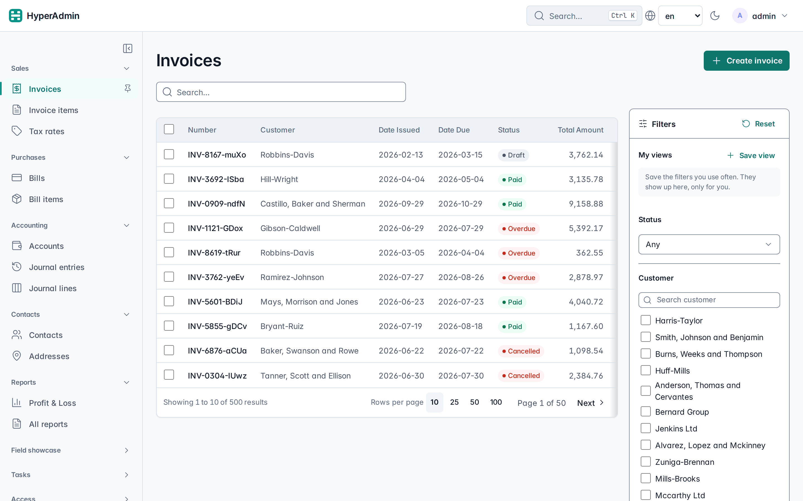
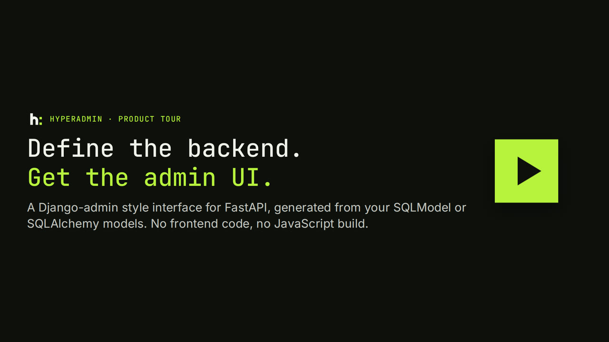
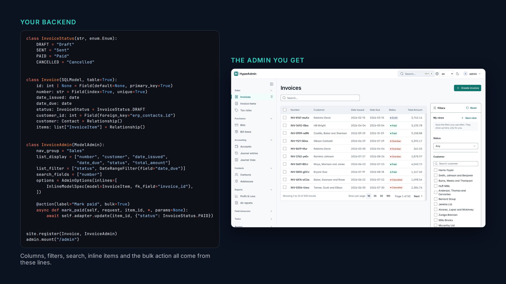
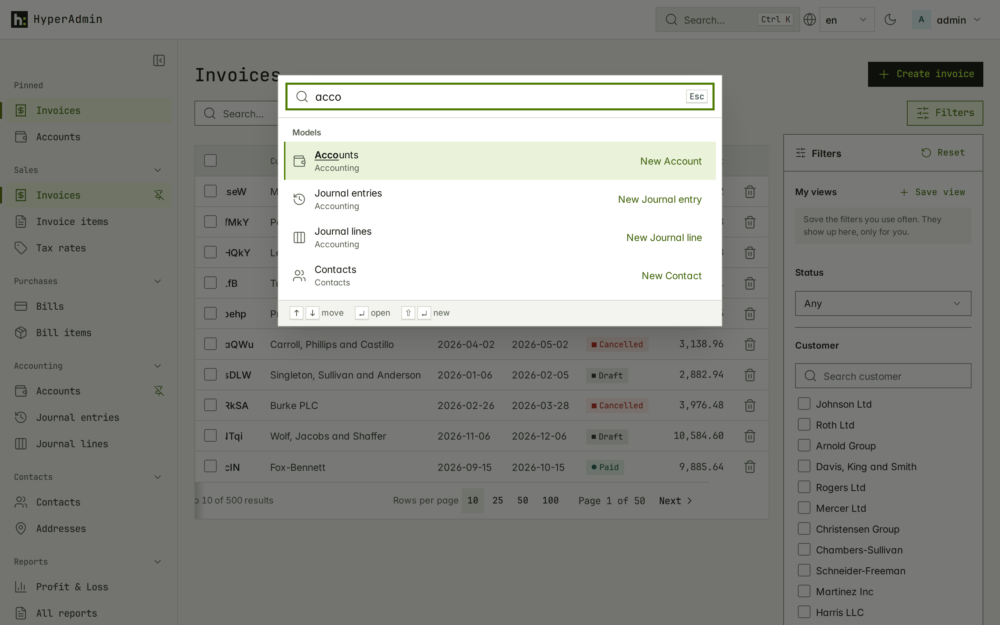
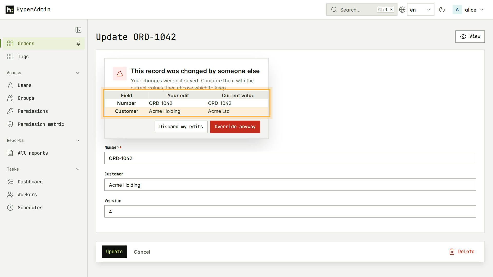
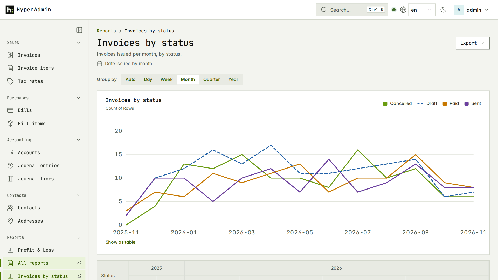
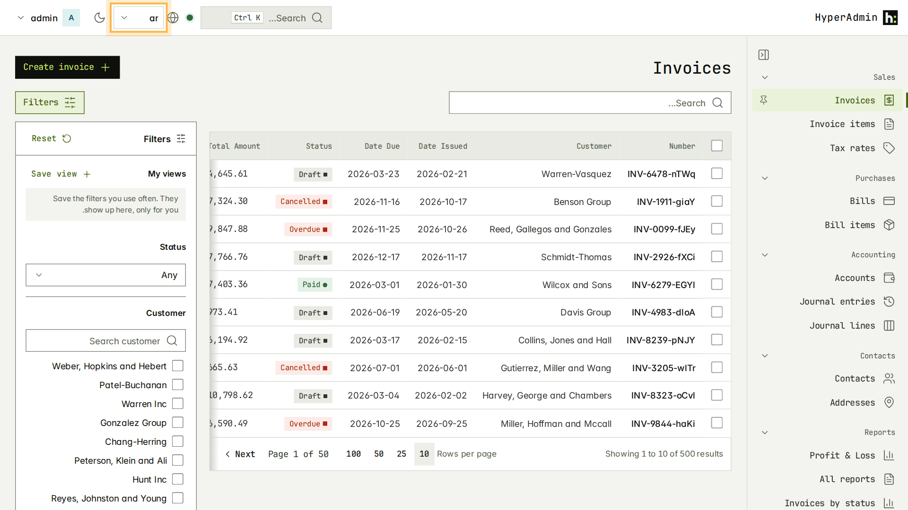

<div align="center">
  <a href="https://yevheniidehtiar.github.io/hyper-admin/" target="_blank">
    <picture>
      <source media="(prefers-color-scheme: dark)" srcset="https://raw.githubusercontent.com/yevheniidehtiar/hyper-admin/develop/src/hyperadmin/static/img/terminal/hyperadmin-wordmark-dark.svg">
      
    </picture>
  </a>
  <p><strong>The Django-admin experience for FastAPI — generated straight from your Pydantic, SQLModel or SQLAlchemy models.</strong><br/>
  Add it to the FastAPI app you already have in about ten minutes, without it taking over.</p>

  <p>
    <a href="https://github.com/yevheniidehtiar/hyper-admin/actions/workflows/ci.yml">
      
    </a>
    <a href="https://yevheniidehtiar.github.io/hyper-admin/">
      
    </a>
    
    <a href="https://github.com/astral-sh/ruff">
      
    </a>
    
    <a href="https://github.com/yevheniidehtiar/hyper-admin/blob/master/LICENSE">
      
    </a>
    <a href="https://codespaces.new/yevheniidehtiar/hyper-admin?devcontainer_path=.devcontainer%2Fdevcontainer.json">
      
    </a>
  </p>

  <sub><strong>Stable</strong> — 1.0: the public API follows <a href="https://yevheniidehtiar.github.io/hyper-admin/versioning/">semantic versioning</a>.</sub>

  <p><a href="https://hyper-admin-demo.onrender.com/admin/"><strong>▶ Try the live demo</strong></a> — sign in with <code>demo</code> / <code>demo</code><br/>
  <sub>Free hosting: the first visit after a quiet spell takes about a minute to wake up. The data resets every night.</sub></p>

  <br/>
  <picture>
    <source media="(prefers-color-scheme: dark)" srcset="https://raw.githubusercontent.com/yevheniidehtiar/hyper-admin/develop/docs/assets/demo/list-dark.png">
    
  </picture>
</div>

## Define the backend, get the UI

Write the models and a few admin options; the pages are generated, with what a backend-only
team would otherwise skip: presence and live lists, a conflict dialog instead of silent
overwrites, fast lists on millions of rows, load-testing tools, plugins and SSO sign-in.
Watch the 100-second tour:

<p align="center">
  <a href="https://yevheniidehtiar.github.io/hyper-admin/demo/#video-tour">
    
  </a>
</p>

<p align="center">
  
</p>

The [Live Demo page](https://yevheniidehtiar.github.io/hyper-admin/demo/#define-the-backend-get-the-ui)
walks through the code line by line.

---

## The story

FastAPI gives you a fast API — but no batteries-included admin, the way Django has. So
every team rebuilds the same CRUD screens by hand, and they drift out of sync with the
models behind them.

HyperAdmin closes that gap. Point it at the SQLModel or plain SQLAlchemy models you **already**
have and it generates a full admin — list, detail, create, update, search, filters,
auth — at a mount point in your existing app. No second schema to maintain, no JavaScript
build step. The models are the single source of truth; the UI can't drift from them
because it's derived from them.

It's built model-first (domain → logic → views → UI).

## Features

**Fits into your app**
- Generated from SQLModel `table=True` models **and** plain SQLAlchemy 2.0 / 2.1 models (`DeclarativeBase` or legacy `declarative_base()`)
- Mounts as an isolated sub-application: your routes, `/static`, cookies and OpenAPI schema stay untouched
- `int`, UUID and natural `str` primary keys; reuses your engine or `session_factory`; creates no tables unless asked
- Bring your own auth (`ExternalAuth`, JWT-friendly) or use the built-in session auth with groups, permissions and email-OTP MFA
- Optional "Sign in with Google / GitHub" (OAuth2 / OIDC with PKCE) on the built-in login page

**CRUD and data entry**
- List, detail, create, edit and delete, with search, sorting and pagination
- Fieldsets, multi-column layouts and inline formsets for related rows; inline cell editing in the list
- FK / M2M selects, async autocomplete, dependent selects, and a "+" popup to create a related record
- Bulk actions with a result for each row, and custom `@action`s that can take a form
- File and image uploads: local or S3-compatible storage, thumbnails, EXIF auto-rotation, drag-and-drop, progress and retry

**Navigation**
- Sidebar grouped by domain with icons, a collapsible icon rail, and per-user pinned pages
- <kbd>⌘K</kbd> command palette over models, pages and recent records
- Rows that open on click (edit or view, by permission), a red delete icon with a confirmation, keyboard shortcuts (`j`/`k`, `x`, `c`, `?`), and a warning before unsaved form changes are lost

**Finding data**
- Filter sidebar (date range, choice, boolean, relation, "mine only"), per-user saved views, filters you can share by URL
- Tabbed, lazy-loaded detail panels, including streamed PDF panels

**Security and permissions**
- CSRF protection that works behind TLS proxies; password, token and secret fields hidden by default
- Object-level permissions, row-level security through `get_queryset`, and a model × action permissions matrix with an audit trail
- Optimistic concurrency: a stale save gets a conflict dialog instead of overwriting a newer change
- Rate limits for the admin and its login

**Collaboration and reporting**
- Live CRUD notifications over SSE / WebSocket (in-memory or Redis pub/sub), plus presence: who else is editing a record
- `hyperadmin-reports` plugin: crosstab reports with filters, server-rendered SVG charts, CSV / XLSX export, and a home-page dashboard of stat, chart and quick-action cards
- `hyperadmin-tasks` plugin: a background task dashboard on Postgres (experimental); `hyperadmin-logfire` plugin: request, adapter and SQL spans in Pydantic Logfire
- Plugin registry for adding pages, navigation, templates, permissions and the home page, plus lifecycle hooks

**Large tables**
- Relations loaded only for the columns shown, cursor pagination, cached and estimated totals, lazy foreign-key options

**Interface**
- Light / dark themes (the `terminal` preset by default, `classic` on request), responsive mobile layout, WCAG 2.1 AA
- 20 locales with right-to-left layout for Arabic and Hebrew; Ukrainian is reviewed, the other catalogs are drafts that show English until reviewed

<table>
  <tr>
    <td></td>
    <td></td>
  </tr>
  <tr>
    <td></td>
    <td></td>
  </tr>
</table>

## Proven on real open-source apps

We mount HyperAdmin on popular open-source FastAPI apps, pinned to an exact commit, **without
modifying their models**, and request every page of every model. The eight bugs that broke
pages are fixed; the smaller gaps still open are listed as known limitations on the
compatibility page.

| App | Stack | Models | Result |
|---|---|---|---|
| [Polar](https://github.com/polarsource/polar) | SQLAlchemy 2.0 async · PostgreSQL · Python 3.14 | 138 | list / search / sort 138 of 138, create 127 of 127, no exceptions |
| [Langflow](https://github.com/langflow-ai/langflow) | SQLModel 0.0.48 · SQLite | 61 | every page renders; zero-config auto-discovery finds all 61 |
| [Mealie](https://github.com/mealie-recipes/mealie) | SQLAlchemy 2.1 (sync app) · SQLite · Python 3.14 | 57 | every page renders |
| [Open WebUI](https://github.com/open-webui/open-webui) | legacy `declarative_base()` · string PKs · SQLite | 44 | every page renders |

Tables with composite primary keys register list-only, by design.

**Performance** (Mealie, 237,757 rows, SQLite, in-process, page size 10): list pages take
28–117 ms, a page halfway through a 100,000-row table costs the same as the first page,
search over 100,000 rows takes 172 ms, and detail pages take about 9 ms. Registering 57 models
takes 0.8 s.

**Under load** (ERP example, PostgreSQL 16, 100,000 rows, one 9-CPU box for app and database,
9 uvicorn workers, Locust with 90% reads and 10% writes): 400 concurrent users get about
**300 requests per second at a median of 21 ms and a p95 of 170 ms, with no errors**. That is
the box's ceiling: at 800 users throughput stays near 300 req/s and requests queue instead.
A second run compares SQLite, PostgreSQL 17 and PostgreSQL 17 with a trigram index on 1.2 million
rows.

Supported stacks, the full results, the timings and known limitations are on
**[Compatibility & Performance](https://yevheniidehtiar.github.io/hyper-admin/compatibility/)**.

## Why the Pydantic stack

| Choice | Why |
|---|---|
| **Pydantic v2 / SQLModel** | Your models already encode types, validation, and field metadata. HyperAdmin reads them directly, so forms, filters and detail views are *generated*, never hand-written — and stay correct by construction. |
| **FastAPI** | Same async runtime, same dependency injection, same app. HyperAdmin mounts in; it doesn't take over. |
| **HTMX + Jinja2** | Server-rendered HTML with interactivity sent over the wire. A rich admin with a tiny JS surface — no SPA, no node build, progressive enhancement by default. |
| **SQLAlchemy 2.x (async)** | A mature, async data layer underneath SQLModel. Plain SQLAlchemy models work too: HyperAdmin builds their schemas from the mapper. Tested on SQLite and PostgreSQL. |

## Quickstart

HyperAdmin follows semantic versioning from 1.0.0.
The distribution is `hyper-admin`; the import name is `hyperadmin`.

```bash
pip install hyper-admin==1.0.0
```

```python
from fastapi import FastAPI
from sqlalchemy.ext.asyncio import create_async_engine
from sqlmodel import SQLModel, Field
from hyperadmin import Admin
from hyperadmin.core.registry import site
from hyperadmin.core.settings import HyperAdminSettings

class Product(SQLModel, table=True):
    id: int | None = Field(default=None, primary_key=True)
    name: str
    price: float

engine = create_async_engine("sqlite+aiosqlite:///app.db")
app = FastAPI()
# create_tables=True is for a quick start; in production, use your own migrations
admin = Admin(app, engine=engine, settings=HyperAdminSettings(create_tables=True))
site.register(Product)
admin.mount("/admin")        # full CRUD admin now live at /admin
```

Requires Python 3.11+. Optional extras: `hyper-admin[realtime]` (WebSocket transport),
`hyper-admin[redis]` (Redis pub/sub for realtime and presence), `hyper-admin[s3]`
(S3-compatible upload storage) and `hyper-admin[oauth]` (Google / GitHub sign-in). Adding the admin to an app you
already have, with your own models, keys and auth, is covered in
[Add HyperAdmin to an existing app](https://yevheniidehtiar.github.io/hyper-admin/guides/existing-app/).

Prefer to click around first? **[Try the live demo](https://hyper-admin-demo.onrender.com/admin/)** (`demo` / `demo`), [open it in Codespaces](https://codespaces.new/yevheniidehtiar/hyper-admin?devcontainer_path=.devcontainer%2Fdevcontainer.json), or browse the [screenshot tour](https://yevheniidehtiar.github.io/hyper-admin/demo/).

## Resource map

| | |
|---|---|
| 📖 **Documentation** | <https://yevheniidehtiar.github.io/hyper-admin/> |
| ▶️ **Live demo & tour** | [hyper-admin-demo.onrender.com](https://hyper-admin-demo.onrender.com/admin/) (`demo` / `demo`) · [docs › Live Demo](https://yevheniidehtiar.github.io/hyper-admin/demo/) · [Open in Codespaces](https://codespaces.new/yevheniidehtiar/hyper-admin?devcontainer_path=.devcontainer%2Fdevcontainer.json) |
| 🚀 **Getting started** | [docs › Getting Started](https://yevheniidehtiar.github.io/hyper-admin/getting-started/) |
| 🔌 **Existing app guide** | [docs › Existing FastAPI App](https://yevheniidehtiar.github.io/hyper-admin/guides/existing-app/) · [docs › Bring Your Own Auth](https://yevheniidehtiar.github.io/hyper-admin/guides/external-auth/) |
| 🔀 **Migration guides** | [docs › Migrating](https://yevheniidehtiar.github.io/hyper-admin/migration/): from [Django admin](https://yevheniidehtiar.github.io/hyper-admin/migration/from-django-admin/), [SQLAdmin](https://yevheniidehtiar.github.io/hyper-admin/migration/from-sqladmin/) and [Flask-Admin](https://yevheniidehtiar.github.io/hyper-admin/migration/from-flask-admin/) |
| ✅ **Compatibility & performance** | [docs › Compatibility & Performance](https://yevheniidehtiar.github.io/hyper-admin/compatibility/) |
| 🧩 **Example apps** | [docs › Examples](https://yevheniidehtiar.github.io/hyper-admin/examples/): simple, ERP, bring-your-own-app, plain SQLAlchemy, full demo · [`examples/`](https://github.com/yevheniidehtiar/hyper-admin/tree/master/examples) |
| 🗺️ **Roadmap** | [docs › Roadmap](https://yevheniidehtiar.github.io/hyper-admin/roadmap/) · [`ROADMAP.md`](https://github.com/yevheniidehtiar/hyper-admin/blob/master/ROADMAP.md) |
| 🏛️ **Architecture** | [`CONSTITUTION.md`](https://github.com/yevheniidehtiar/hyper-admin/blob/master/CONSTITUTION.md) — principles, module boundaries, dependency rules |
| 🤝 **Contributing** | [`CONTRIBUTING.md`](https://github.com/yevheniidehtiar/hyper-admin/blob/master/CONTRIBUTING.md) · [`CODE_OF_CONDUCT.md`](https://github.com/yevheniidehtiar/hyper-admin/blob/master/CODE_OF_CONDUCT.md) |
| 🔒 **Security** | [`SECURITY.md`](https://github.com/yevheniidehtiar/hyper-admin/blob/master/SECURITY.md) |
| 📓 **Changelog** | [docs › Changelog](https://yevheniidehtiar.github.io/hyper-admin/changelog/) |
| 🏷️ **Versioning** | [docs › Versioning & Deprecation Policy](https://yevheniidehtiar.github.io/hyper-admin/versioning/) |

## Tech stack

**[FastAPI](https://fastapi.tiangolo.com/)** ·
**[Pydantic v2](https://docs.pydantic.dev/)** ·
**[SQLModel](https://sqlmodel.tiangolo.com/)** / **[SQLAlchemy 2.0](https://www.sqlalchemy.org/)** ·
**[HTMX](https://htmx.org/)** ·
**[Jinja2](https://jinja.palletsprojects.com/)** ·
[Starlette](https://www.starlette.io/) sessions ·
[Argon2](https://argon2-cffi.readthedocs.io/) ·
[Babel](https://babel.pocoo.org/) i18n ·
[Typer](https://typer.tiangolo.com/) CLI ·
[uv](https://docs.astral.sh/uv/) + [Ruff](https://docs.astral.sh/ruff/)

## Development

```bash
just bootstrap   # set up the dev environment (uv sync --all-extras)
just lint        # ruff + mypy + commitizen
just test        # unit tests (just test-e2e for Playwright e2e)
just run-erp     # run the example ERP admin locally
just docs        # serve docs locally on :8080
```

## Acknowledgements

Standing on the shoulders of [FastAPI](https://fastapi.tiangolo.com/),
[Pydantic](https://docs.pydantic.dev/), [HTMX](https://htmx.org/), and
[SQLModel](https://sqlmodel.tiangolo.com/) / [SQLAlchemy](https://www.sqlalchemy.org/) —
and built with AI-assisted development via [Claude](https://www.anthropic.com/).

## License

MIT — see [LICENSE](https://github.com/yevheniidehtiar/hyper-admin/blob/master/LICENSE).
