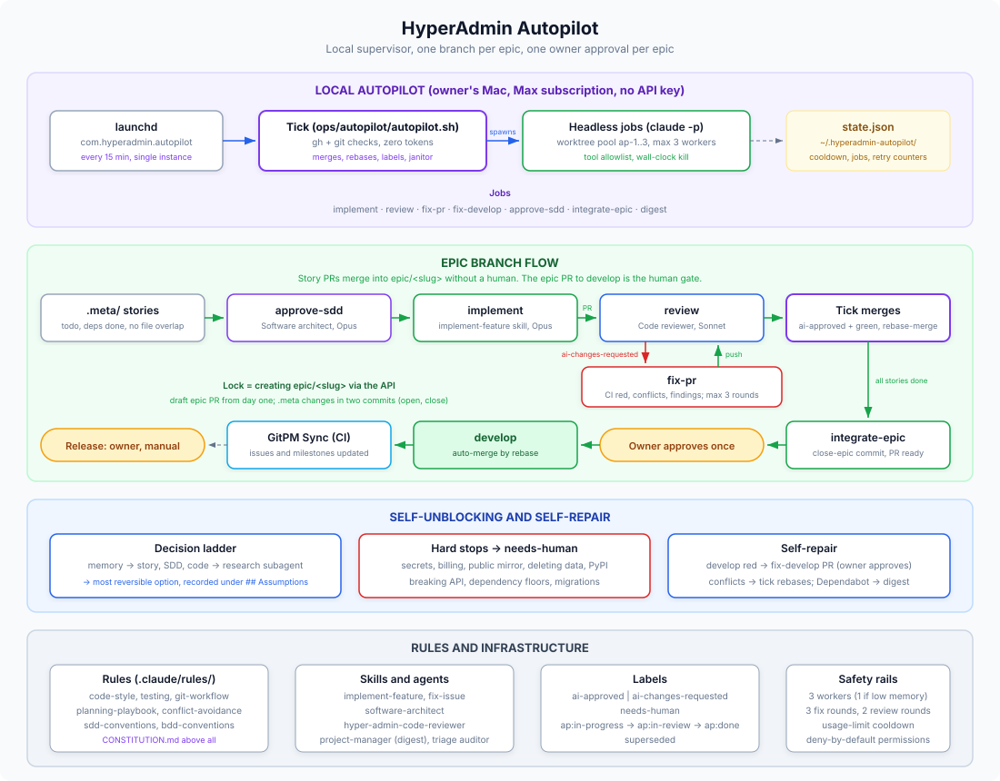

# Agentic Workflow

!!! abstract "Reusable Pattern"
    The agent roles, branch model, supervisor loop, and safety rails described
    here are generic. They can be adopted by any OSS project using Claude Code.
    HyperAdmin-specific configuration (CONSTITUTION.md, review checklist, project IDs)
    is layered on top and clearly marked.

!!! tip "New here?"
    Start with the [Onboarding guide](onboarding.md) for a quick orientation.

This project is delivered by an **autopilot**: a local supervisor that runs every
15 minutes on the owner's Mac and starts headless Claude Code jobs to implement
stories, review PRs, repair CI and integrate epics. Work is planned in `.meta/`
files (GitPM). The owner approves one pull request per epic.

The full design is on the [Orchestration](orchestration.md) page.

## Architecture



## How work flows

```
.meta/ story (todo)
  → tick claims the epic: creates epic/<slug> via the API, opens a draft epic PR
  → approve-sdd      architect agent approves the spec
  → implement        dev agent opens a story PR against epic/<slug>
  → review           reviewer sets ai-approved or ai-changes-requested
  → fix-pr           repairs CI or review findings (max 3 rounds)
  → tick             rebase-merges the green, approved story PR into the epic branch
  → integrate-epic   close-epic commit, PR marked ready, auto-merge armed
  → owner            approves the epic PR once; it merges into develop
  → GitPM Sync       updates issues and milestones
```

## Component relationships

```
launchd (com.hyperadmin.autopilot, every 15 min)
└─ ops/autopilot/autopilot.sh tick
   ├─ deterministic checks (gh, git)      no tokens
   ├─ merges, rebases, labels, janitor    no tokens
   └─ headless jobs in .claude/worktrees/ap-1..3
      ├─ implement ───────→ implement-feature skill ◄──── rules (.claude/rules/)
      ├─ review ──────────→ hyper-admin-code-reviewer agent
      ├─ fix-pr / fix-develop
      ├─ approve-sdd ─────→ software-architect agent
      ├─ integrate-epic
      └─ digest ──────────→ owner (Slack or standing issue)

Interactive entry points
├─ /implement-feature, /fix-issue    one story by hand
├─ /plan-to-issues, /plan-roadmap    write .meta/ stories
├─ /autopilot-tick                   one tick, for debugging
└─ /oss-triage-audit                 community triage
```

## Jobs and agents

| Job | Agent or skill | Model | Started when |
|-----|----------------|-------|--------------|
| `implement` | `implement-feature` skill | Opus | A story is ready and a worker slot is free |
| `review` | `hyper-admin-code-reviewer` | Sonnet | A story PR has green checks and no verdict |
| `fix-pr` | Dev agent | Opus | Checks fail, the PR conflicts, or it has `ai-changes-requested` |
| `fix-develop` | Dev agent | Opus | A push run on `develop` is red |
| `approve-sdd` | `software-architect` | Opus | An epic's `review(spec)` story is todo |
| `integrate-epic` | Dev agent | Sonnet | All stories of an epic are done |
| `digest` | `project-manager` template | Haiku | Daily |

The OSS Triage Auditor (Sonnet) runs ad hoc for community issues and PRs.

## Core Principles

- **Mandatory TDD**: Every functional change begins with failing tests. Implementation follows.
- **Bottom-Up Architecture**: Models → Business Logic → Views → UI (never the reverse).
- **Git-Native PM**: All issue/epic/milestone state lives in `.meta/` files, synced to GitHub by CI.
- **One branch per epic**: Story PRs merge into `epic/<slug>` without a human. The epic PR to `develop` is the human gate.
- **Decide, record, continue**: Agents resolve ambiguity with a fixed ladder and write down their assumptions instead of stopping.
- **Deny by default**: Jobs run with an explicit tool allowlist. Releases, repo settings and the public mirror are out of reach.

## Label State Machine

Story PR:

```
opened → (review job) → ai-approved ──────────→ rebase-merged into epic/<slug>
                      ↘ ai-changes-requested → fix-pr → review again (max 2 rounds)

any state → needs-human   hard stop or retry budget exhausted
```

Story issue (mid-epic visibility, written by the tick):

```
ap:in-progress → ap:in-review → ap:done
```

| Transition | Owner |
|------------|-------|
| idea → researched | Deep research (Claude Opus) |
| researched → planned | Roadmap planning (Claude Opus) |
| planned → approved | **Owner** |
| story claimed → `ap:in-progress` | Tick |
| PR opened → `ap:in-review` | Tick |
| PR reviewed → `ai-approved` / `ai-changes-requested` | `review` job |
| PR merged into the epic branch → `ap:done` | Tick |
| Epic PR approved | **Owner** (once per epic) |
| Status labels after the epic merges | GitPM Sync |

## Owner touchpoints

1. Approve one PR per epic.
2. Approve the occasional `fix-develop` or Dependabot PR to `develop`.
3. Answer `needs-human` questions listed in the daily digest.
4. Cut releases (`develop` → `master`, PyPI).

## Safety Rails

| Limit | Value | Purpose |
|-------|-------|---------|
| Concurrent workers | 3 (1 when memory is low) | Prevent resource exhaustion |
| Fix rounds per PR | 3 | Then `needs-human` |
| Review rounds per PR | 2 | Then `needs-human` |
| CI rerun | Once, only for cancelled or timed-out runs | No blind retries |
| Human approval | Every change to `develop` | Protect the integration branch |
| Hard stops | Secrets, billing, public mirror, data deletion, PyPI, breaking API, dependency floors, migrations | Always escalated |
| Usage limit | Cooldown recorded in state; no model jobs until it passes | No wasted runs |
