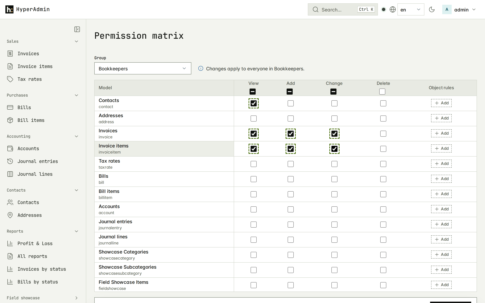

# Authentication & Permissions

HyperAdmin has two auth modes. With **built-in auth** the admin keeps its own users, groups and
permissions in the `hyperadmin_*` tables (`User`, `Group`, `Permission`) and signs users in with
`SessionAuthBackend`. With **bring your own auth** you pass `Admin(auth=ExternalAuth(...))` and
the host application decides who the user is and what they may do; see
[Bring Your Own Auth](../guides/external-auth.md).

```python
from hyperadmin import Admin
from hyperadmin.auth.permissions import ModelPermissionChecker, PermissionSyncService
from hyperadmin.auth.session import SessionAuthBackend

admin = Admin(
    app,
    engine=engine,
    auth_backend=SessionAuthBackend(engine),
    permission_checker=ModelPermissionChecker(engine),
    permission_registry=PermissionSyncService(engine),
)
```

`hyperadmin.auth.metadata()` returns the built-in tables as an Alembic `target_metadata`.

## Permission codenames

The admin asks for `view_<model>`, `add_<model>`, `change_<model>`, `delete_<model>` and, for a
custom action, `action_<name>_<model>` (for example `action_archive_order`). `<model>` is the
lowercased model class name, so two models with an action of the same name have separate
permissions.

A detail-page panel checks `view_<model>_panel_<slug>`, or the `permission=` it was declared with.

At startup `PermissionSyncService` creates, for every registered model:

- the four `view_`, `add_`, `change_` and `delete_` codenames;
- one `action_<name>_<model>` codename per `@action` method of its `ModelAdmin`;
- the codename of every detail panel (`AdminOptions.panels` and `@panel` methods);
- the extra codenames listed in `ModelAdmin.permissions`.

Existing rows are never changed or removed. Grant the new codenames to a group or a user like
the four defaults.

!!! note "Earlier docs said `action_<name>`"
    The model-level check has always been `action_<name>_<model>`; earlier versions of these
    pages named it `action_<name>`. The object-level check
    (`AdminOptions.object_permission_checker`) receives `action_<name>`, without the model,
    because the checker is already given the object.

### Extra codenames: `ModelAdmin.permissions`

A `ModelAdmin` can declare codenames of its own, for checks you make in your own code (an
action handler, a custom view, a template). Set `permissions` to a list of
`(codename, name)` pairs; `PermissionSyncService` creates them at startup and the permissions
matrix shows them as extra columns of the model's row:

```python
class OrderAdmin(ModelAdmin):
    permissions = [
        ("export_order", "Can export orders"),
        ("refund_order", "Can refund orders"),
    ]
```

Check one with the admin's permission checker, for example
`await admin.permission_checker.has_permission(user, "refund_order")`.

## Permissions matrix

With built-in auth (or bring-your-own-auth with `register_auth_models=True`), the "Access"
sidebar group has a permissions matrix at `{prefix}/permissions-matrix/`: one row per model, one
column per codename, for the group you pick. A save writes only the cells that changed. When
someone else saved the same group in the meantime, the page shows a conflict banner instead of
overwriting their change. Every change is written to the `hyperadmin_permission_audit` table.



Superusers can always open it; other users need the `permissions_matrix_codename` permission
(`change_groups_permissions` by default). `permissions_matrix_enabled=False` leaves the page
out. The tables it needs are listed in
[Upgrading the built-in auth tables](../guides/existing-app.md#upgrading-the-built-in-auth-tables).

## Caches

`ModelPermissionChecker` remembers the permission set it read on the user object for the rest of
the request; call `forget_user_permissions(user)` after a write that changes it. With
`user_cache_ttl` set, the signed-in user is also cached per worker; call
`invalidate_user(user_id)` after you change a user outside the admin.

## API Reference

::: hyperadmin.auth.ExternalAuth

::: hyperadmin.auth.TokenCookie

::: hyperadmin.auth.session.SessionAuthBackend

::: hyperadmin.auth.permissions.ModelPermissionChecker

::: hyperadmin.auth.permissions.PermissionSyncService

::: hyperadmin.auth.permissions.forget_user_permissions

::: hyperadmin.auth.user_cache.invalidate_user

::: hyperadmin.auth.metadata

::: hyperadmin.auth.User

::: hyperadmin.auth.Group

::: hyperadmin.auth.Permission

### OAuth sign-in

These names need the `oauth` extra and are imported from `hyperadmin` on first access.

::: hyperadmin.auth.oauth.OAuthBackend

::: hyperadmin.auth.oauth.OAuthProviderConfig

::: hyperadmin.auth.oauth.github_provider

::: hyperadmin.auth.oauth.google_provider

::: hyperadmin.auth.oauth.OAuthProviderError

::: hyperadmin.auth.oauth.AccountLinkRequiredError
