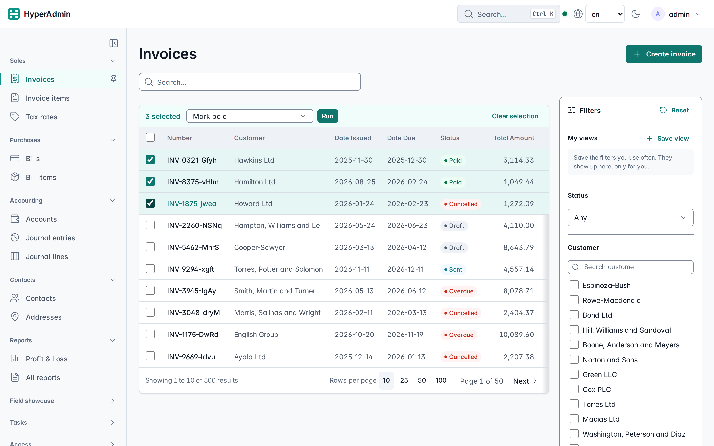
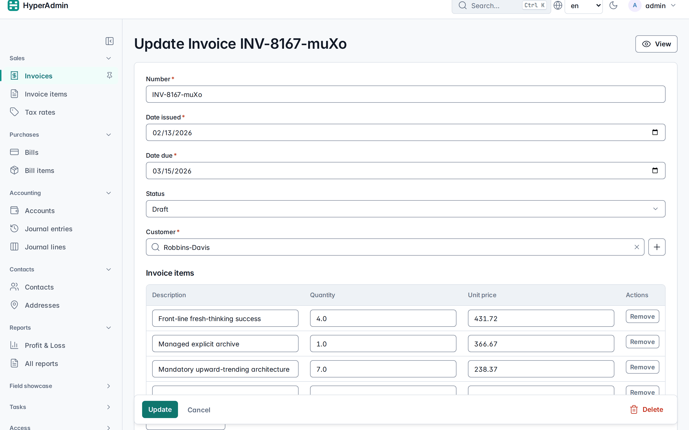
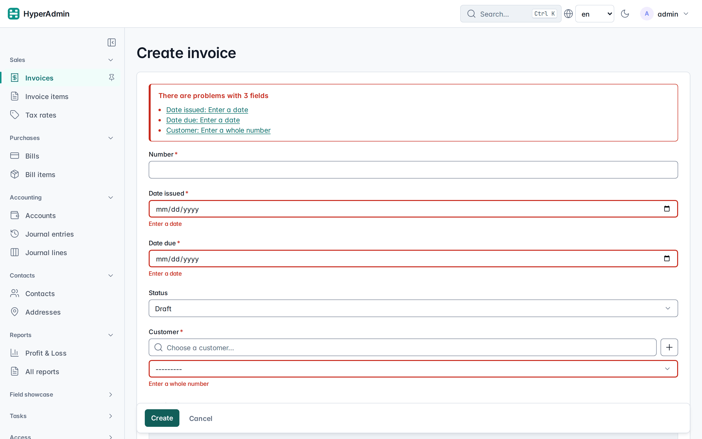
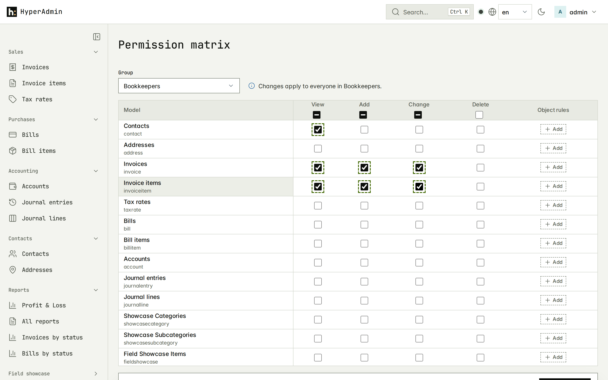
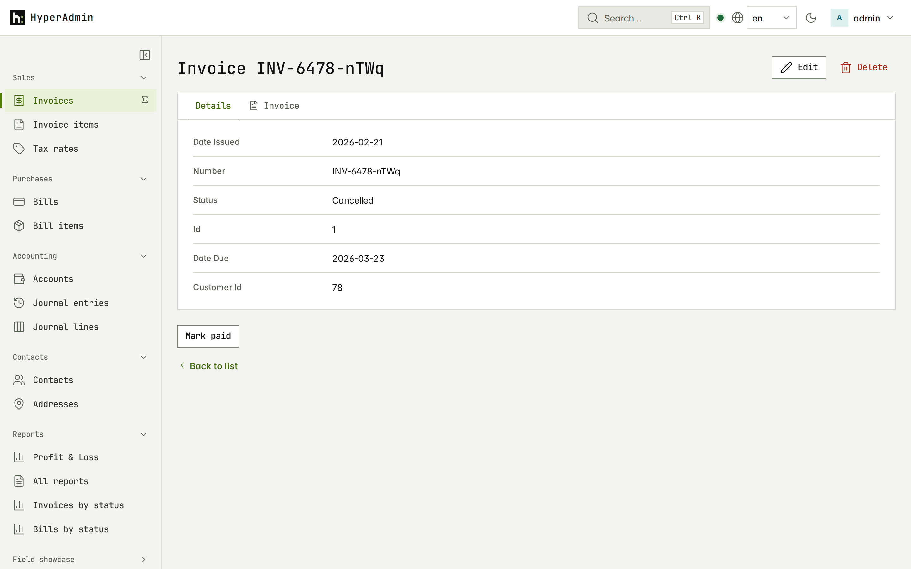
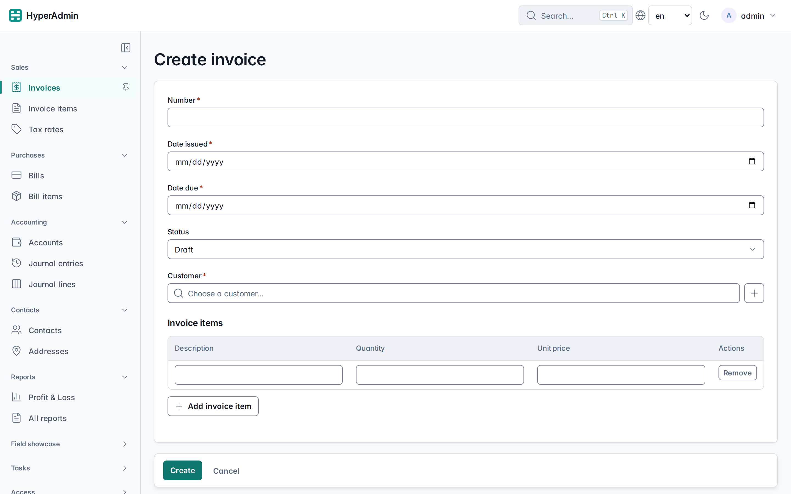
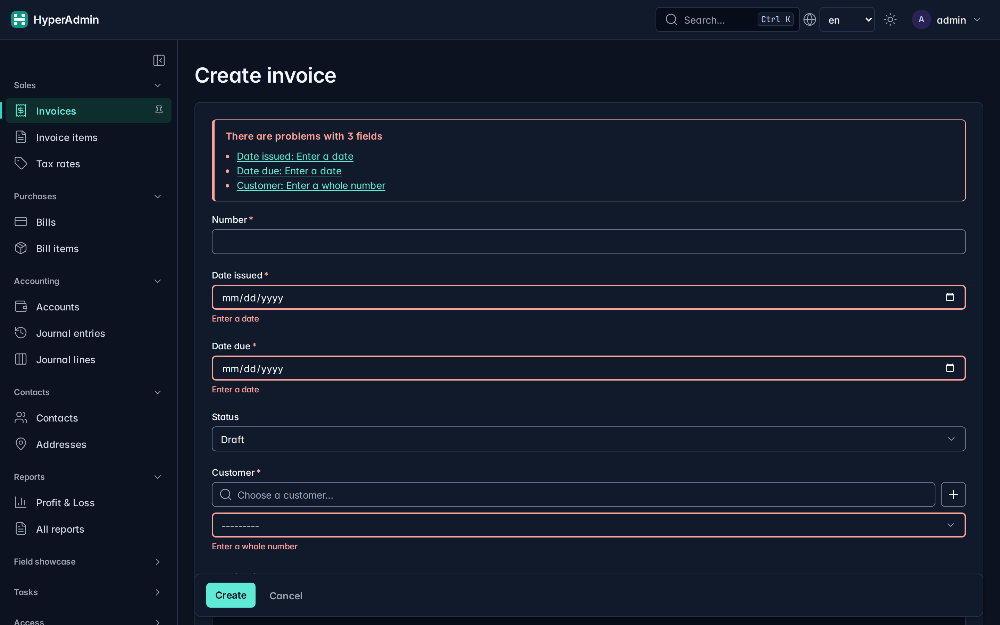
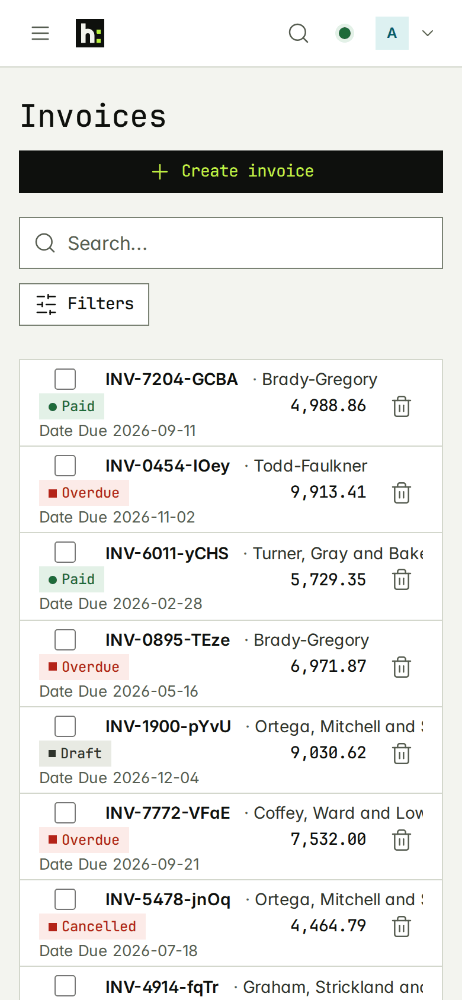

# Live Demo

HyperAdmin is a **server-side** admin framework — it renders pages with Jinja2,
serves HTMX requests from real FastAPI endpoints, and manages sessions. That means
a static host (like GitHub Pages, where these docs live) cannot run it: it needs a
Python process.

So this page gives you four ways to experience HyperAdmin:

1. A **video tour** (below): 80 seconds, from model code to the finished admin.
2. The **hosted demo** of the bundled ERP example: open it and sign in.
3. A **screenshot tour** (below): no setup, runs in your browser right here.
4. A **one-click live environment** via GitHub Codespaces, where you run the app yourself.

---

## Video tour

<video controls preload="none" width="100%" poster="../assets/demo/hyperadmin-demo-poster.jpg">
  <source src="assets/demo/hyperadmin-demo.webm" type="video/webm">
  <source src="assets/demo/hyperadmin-demo.mp4" type="video/mp4">
  Your browser cannot play this video.
  <a href="assets/demo/hyperadmin-demo.mp4">Download the MP4</a> instead.
</video>

The tour runs on the ERP example with synthetic data. It is generated by
[`scripts/demo_tour_video.py`](https://github.com/yevheniidehtiar/hyper-admin/blob/develop/scripts/demo_tour_video.py),
so it can be re-recorded whenever the UI changes.

---

## Define the backend, get the UI

HyperAdmin is for teams and developers who want to write the backend (the models and a few
admin options) and not build a CRUD frontend by hand. The UI below is generated; nothing in
it is a hand-written template.


### 1. The models you already have

A plain SQLModel (or SQLAlchemy 2.0) model. The field types decide the form widgets: `date`
becomes a date picker, the `InvoiceStatus` enum a select and a coloured status pill, the
foreign key an autocomplete with a "+" button to create a customer in place.

```python
class InvoiceStatus(str, enum.Enum):
    DRAFT = "Draft"
    SENT = "Sent"
    PAID = "Paid"
    CANCELLED = "Cancelled"


class Invoice(SQLModel, table=True):
    id: int | None = Field(default=None, primary_key=True)
    number: str = Field(index=True, unique=True)
    date_issued: date
    date_due: date
    status: InvoiceStatus = InvoiceStatus.DRAFT
    customer_id: int = Field(foreign_key="erp_contacts.id")
    customer: Contact = Relationship()
    items: list["InvoiceItem"] = Relationship()
```

### 2. A few admin options

Each option maps to one visible part of the page. Leave the class out entirely
(`site.register(Invoice)`) and you still get a working list, detail and form.

```python
class InvoiceAdmin(ModelAdmin):
    nav_group = "Sales"                                   # sidebar group
    list_display = ["number", "customer", "date_issued",  # list columns
                    "date_due", "status", "total_amount"]
    list_filter = ["status", DateRangeFilter(field="date_due")]  # filter sidebar
    search_fields = ["number"]                            # search box
    options = AdminOptions(inlines=[                      # related rows on the form
        InlineModelSpec(model=InvoiceItem, fk_field="invoice_id"),
    ])

    @action(label="Mark paid", bulk=True)                 # bulk action
    async def mark_paid(self, request, item_id, *, params=None):
        await self.adapter.update(item_id, {"status": InvoiceStatus.PAID})


site.register(Invoice, InvoiceAdmin)
admin.mount("/admin")
```

The full version is in
[`examples/erp/sales/`](https://github.com/yevheniidehtiar/hyper-admin/tree/develop/examples/erp/sales).

### 3. What you get

| Option | Result |
|---|---|
| `list_display`, `search_fields`, `list_filter` | A sortable, paginated list with a search box and a filter sidebar. Search, filters, sort and page live in the URL. |
| Field types | A create/edit form with the right widget per field, server-side validation and an error summary. |
| `InlineModelSpec` | The invoice items edited on the invoice page. |
| `@action(bulk=True)` | Row checkboxes, a bulk bar, and a result page with the outcome of every row. |
| Built-in auth | Login, users, groups and a permissions matrix; a user without a permission cannot use it. |
| Nothing at all | Dark mode, phone layout, ⌘K command palette, keyboard shortcuts, 20 locales. |










Your own pages join the same layout through the plugin API: the ERP adds a dashboard and a
Profit & Loss report next to the generated pages.

|  |  |
|---|---|

---

## Hosted demo

**[hyper-admin-demo.onrender.com/admin/](https://hyper-admin-demo.onrender.com/admin/)** —
sign in with **`demo` / `demo`**.

The demo account can manage every ERP record (contacts, invoices, bills, accounts, journal
entries, the profit-and-loss report) but not users, groups or permissions.

- It runs on a free plan and sleeps after 15 minutes without visitors, so the first page
  can take about a minute to load.
- The data is synthetic and is reset every night and on every deploy. Other visitors see
  what you enter until then, so please don't type real personal data.
- It is deployed automatically from the `develop` branch.

---

## Try it live in Codespaces

[](https://codespaces.new/yevheniidehtiar/hyper-admin?devcontainer_path=.devcontainer%2Fdevcontainer.json)

Click the badge to launch a ready-to-run dev environment (dependencies install
automatically). Once it's up, start the ERP demo:

```bash
uv run fastapi dev examples/erp/main.py --host 0.0.0.0
```

Codespaces forwards port **8000** automatically — open the preview to use the admin.
The demo seeds itself on boot (a small SQLite database, `erp.db`), so you get a fully
populated bookkeeping app: contacts, sales, purchases, accounting, and reports.

> Log in with the seeded superuser (see `examples/erp/seed.py` for credentials).

---

## Screenshot tour

The screenshots below are taken from the ERP demo above, unedited. They show exactly what
the framework renders.

### Login

Session-based authentication out of the box.


### List view

Sortable, searchable, paginated tables generated from your models — no boilerplate.


Dark mode follows the operating system, or the toggle in the navbar.


### Detail view

Per-record detail pages with related data and row actions.



### Create / edit form

Forms derived from your Pydantic/SQLModel fields, with server-side validation and
inline field errors.



Validation errors in dark mode:



### Permissions

The read-only demo account (`demo_ro`) opens rows as read-only detail pages and has no
delete buttons; the server refuses any change it attempts.


### Responsive by default

The same UI adapts to small screens.

{ width="320" }

---

## Run it locally

The demo lives in [`examples/erp/`](https://github.com/yevheniidehtiar/hyper-admin/tree/develop/examples/erp).

### With Docker

```bash
cd examples/erp
docker compose up --build
```

### Without Docker

```bash
uv sync --all-extras
uv run fastapi dev examples/erp/main.py --host 0.0.0.0
```

Then open <http://localhost:8000/admin/>.

The app uses SQLite (`sqlite+aiosqlite:///erp.db`) and reseeds on startup, so it is
safe to delete `erp.db` and start fresh at any time.
