# Live Demo

HyperAdmin is a **server-side** admin framework — it renders pages with Jinja2,
serves HTMX requests from real FastAPI endpoints, and manages sessions. That means
a static host (like GitHub Pages, where these docs live) cannot run it: it needs a
Python process.

So this page gives you four ways to experience HyperAdmin:

1. A **video tour** (below): about 100 seconds on what HyperAdmin adds beyond create, edit and
   delete.
2. The **hosted demo** of the bundled ERP example: open it and sign in.
3. A **screenshot tour** (below): no setup, runs in your browser right here.
4. A **one-click live environment** via GitHub Codespaces, where you run the app yourself.

---

## Video tour

<video controls preload="none" width="100%" poster="../assets/demo/hyperadmin-demo-poster.jpg">
  <source src="assets/demo/hyperadmin-demo.webm" type="video/webm">
  <source src="assets/demo/hyperadmin-demo.mp4" type="video/mp4">
  Your browser cannot play this video.
  <a href="assets/demo/hyperadmin-demo.mp4">Download the MP4</a> instead.
</video>

Every admin panel lists, creates, edits and deletes rows, so the tour skips that and shows what
a backend-only team gets on top, without writing frontend code:

| Scene | What it shows | Read more |
|---|---|---|
| Code to UI | The model and admin options next to the list they generate | [Walkthrough](#define-the-backend-get-the-ui) |
| Presence | Two users on one invoice see each other, live | [Realtime](guides/realtime.md) |
| Live lists | A save in one browser updates the list in the other, no reload | [Realtime](guides/realtime.md#live-crud-notifications) |
| Conflict dialog | Two people save the same order; the second gets a field-by-field diff | `AdminOptions(enforce_occ=True)` |
| Large tables | 1.2 million rows: keyset pages, relations in one query, cached totals | [Performance](guides/performance.md) |
| Load testing | `hyperadmin seed`, then a read run and a write run with Locust, logins excluded | [Load testing](compatibility.md#load-testing-your-own-deployment) |
| Plugins | Dashboard widgets, the ERP's pivot reports with a chart, background tasks, Logfire traces | [Reports and dashboard](plugins/reports.md), [Background tasks](plugins/tasks.md), [Logfire](plugins/logfire.md) |
| Auth | OAuth sign-in, the permissions matrix, a read-only user without Create or Delete buttons | [OAuth SSO](guides/oauth-sso.md) |
| Everyday UI | ⌘K palette, the language switcher (Ukrainian, then Arabic right to left), dark mode, phone layout | [Navigation](guides/navigation.md), [Languages](guides/i18n.md) |
| Widgets | A montage of 17 generated components | [Widgets](frontend/widgets.md) |

Every figure in the video was measured during the recording (server response times, SQL
statement counts, the seeding time and two 30-second Locust measurements, each run twice on an
idle host with the second run shown, all on SQLite on a laptop), except
the PostgreSQL throughput, which is quoted from the
[load-test matrix](compatibility.md#under-load) and labelled so. Data is synthetic.

The video and the feature screenshots are generated by
[`scripts/demo_tour_video.py`](https://github.com/yevheniidehtiar/hyper-admin/blob/develop/scripts/demo_tour_video.py),
so they can be re-recorded whenever the UI changes. They show the default `terminal` theme
preset (near-black or light ground, acid-green accent, square corners); set
`HyperAdminSettings(theme_preset="classic")` for the earlier teal look, see
[Theme presets](frontend/overview.md#theme-presets).

---

## Define the backend, get the UI

HyperAdmin is for teams and developers who want to write the backend (the models and a few
admin options) and not build a CRUD frontend by hand. The UI below is generated; nothing in
it is a hand-written template.

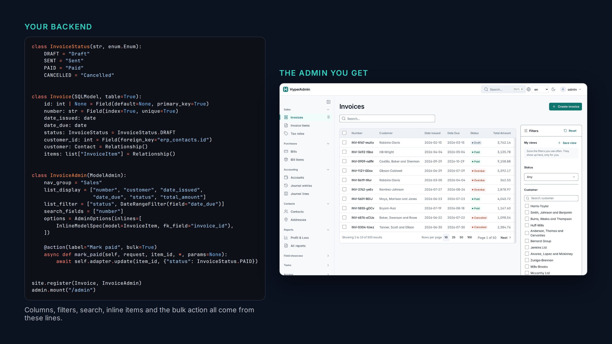

### 1. The models you already have

A plain SQLModel (or SQLAlchemy 2.0) model. The field types decide the form widgets: `date`
becomes a date picker, the `InvoiceStatus` enum a select and a coloured status pill, the
foreign key an autocomplete with a "+" button to create a customer in place.

```python
class InvoiceStatus(str, enum.Enum):
    DRAFT = "Draft"
    SENT = "Sent"
    PAID = "Paid"
    CANCELLED = "Cancelled"


class Invoice(SQLModel, table=True):
    id: int | None = Field(default=None, primary_key=True)
    number: str = Field(index=True, unique=True)
    date_issued: date
    date_due: date
    status: InvoiceStatus = InvoiceStatus.DRAFT
    customer_id: int = Field(foreign_key="erp_contacts.id")
    customer: Contact = Relationship()
    items: list["InvoiceItem"] = Relationship()
```

### 2. A few admin options

Each option maps to one visible part of the page. Leave the class out entirely
(`site.register(Invoice)`) and you still get a working list, detail and form.

```python
class InvoiceAdmin(ModelAdmin):
    nav_group = "Sales"                                   # sidebar group
    list_display = ["number", "customer", "date_issued",  # list columns
                    "date_due", "status", "total_amount"]
    list_filter = ["status", DateRangeFilter(field="date_due")]  # filter sidebar
    search_fields = ["number"]                            # search box
    options = AdminOptions(inlines=[                      # related rows on the form
        InlineModelSpec(model=InvoiceItem, fk_field="invoice_id"),
    ])

    @action(label="Mark paid", bulk=True)                 # bulk action
    async def mark_paid(self, request, item_id, *, params=None):
        await self.adapter.update(item_id, {"status": InvoiceStatus.PAID})


site.register(Invoice, InvoiceAdmin)
admin.mount("/admin")
```

The full version is in
[`examples/erp/sales/`](https://github.com/yevheniidehtiar/hyper-admin/tree/develop/examples/erp/sales).

### 3. What you get

| Option | Result |
|---|---|
| `list_display`, `search_fields`, `list_filter` | A sortable, paginated list with a search box and a filter sidebar. Search, filters, sort and page live in the URL. |
| Field types | A create/edit form with the right widget per field, server-side validation and an error summary. |
| `InlineModelSpec` | The invoice items edited on the invoice page. |
| `@action(bulk=True)` | Row checkboxes, a bulk bar, and a result page with the outcome of every row. |
| Built-in auth | Login, users, groups and a permissions matrix; a user without a permission cannot use it. |
| Nothing at all | Dark mode, phone layout, ⌘K command palette, keyboard shortcuts, 20 locales. |

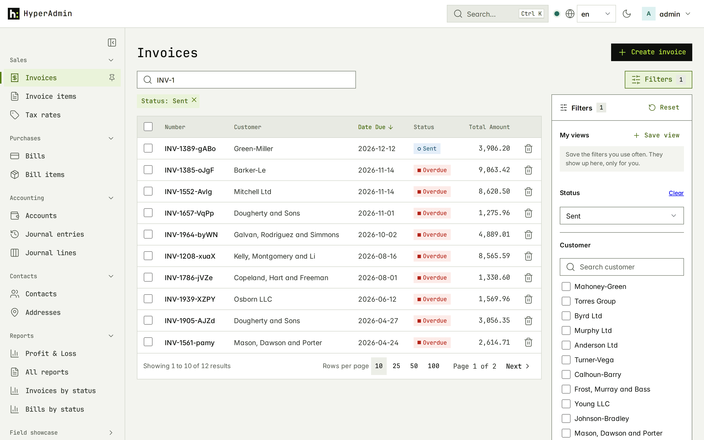


Your own pages join the same layout through the plugin API: the ERP adds a dashboard and a
Profit & Loss report next to the generated pages.

| 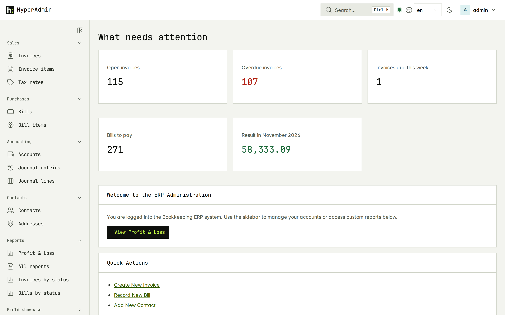 | 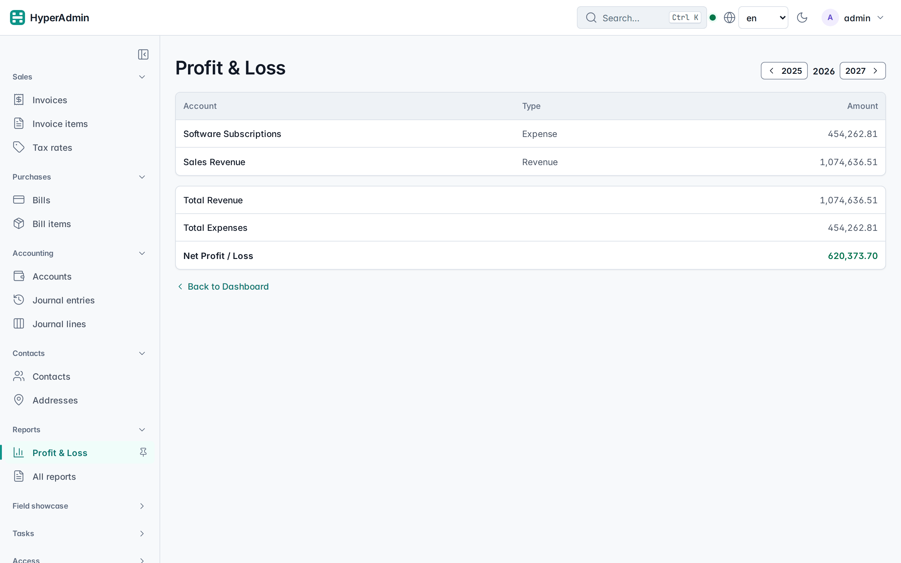 |
|---|---|

### 4. What you get beyond CRUD

The parts a backend team would otherwise have to build, or would skip. Each is a setting, not
frontend work. The screenshots are frames of the video tour.

**Presence and live lists.** With `realtime=RealtimeSettings()`, editors see who else is on
the record, and list pages pick up other people's changes without a reload.
See [Realtime](guides/realtime.md).

| 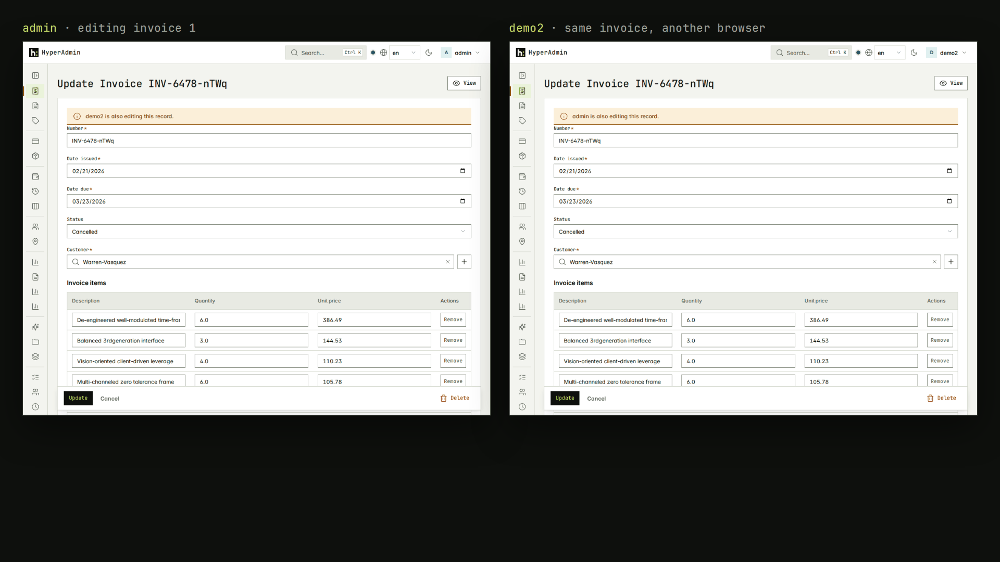 | 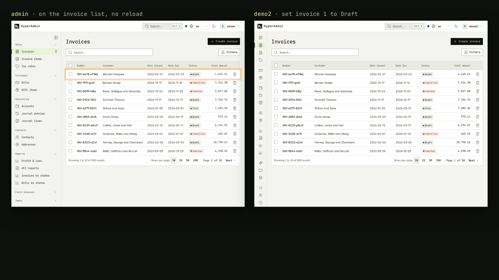 |
|---|---|

**No silent overwrites.** With `AdminOptions(enforce_occ=True)` and a `version` column, a save
made against an out-of-date copy is refused with a dialog that compares both values field by
field; the user keeps theirs or reloads.


**Large tables.** Keyset pagination, relations loaded with one query per page, cached and
estimated totals. Measured on 1.2 million SQLite rows during the recording; the settings are in
[Large Tables and Performance](guides/performance.md).

| 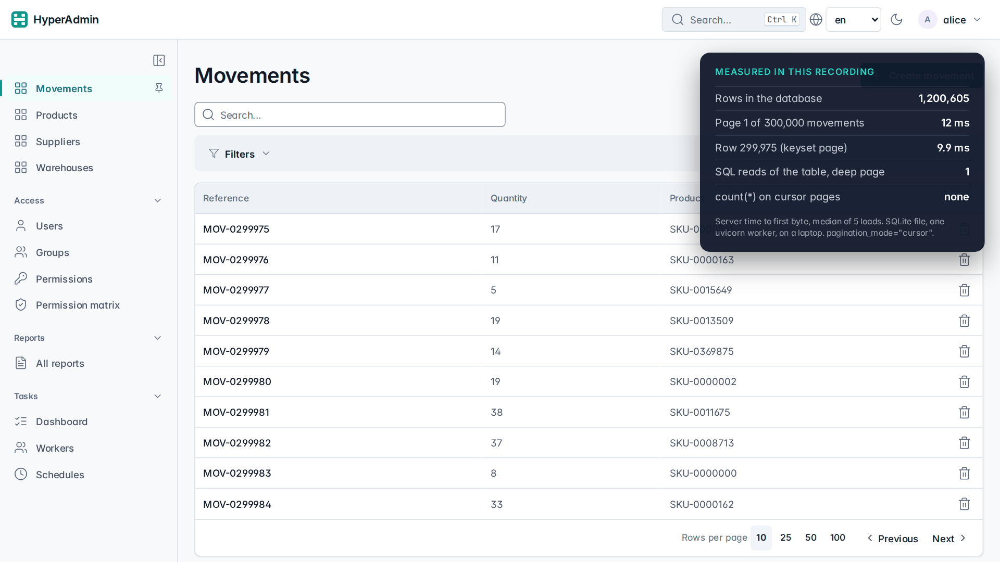 | 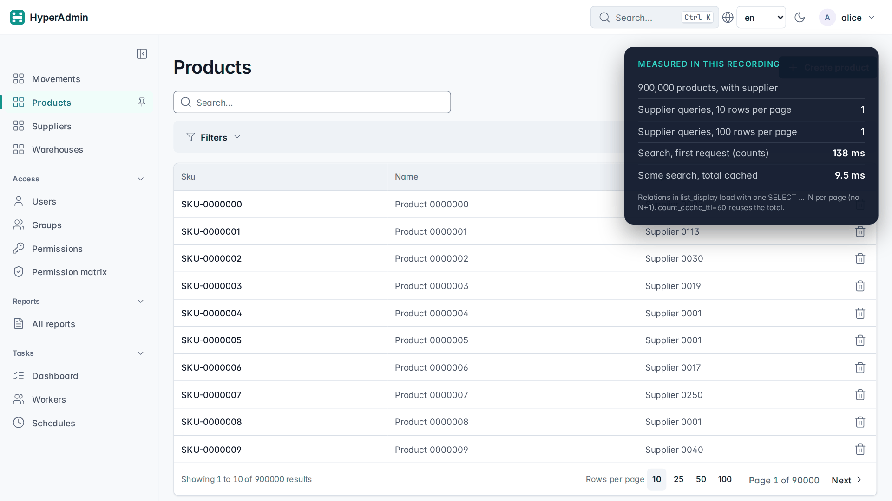 |
|---|---|

**Load testing.** `hyperadmin seed` fills a database with realistic rows and the ERP example
ships a Locust suite. The tour seeds 1.2 million rows, then measures two runs of 20 users for
30 seconds each against them: reads (list, detail, search) and writes (create, update and
delete of the rows the run itself creates, so the table keeps its size). The card also gives
reads without search (list and detail only). Runs start only once the host has been idle for
two minutes, and each measurement runs twice so the second one sees a warm file cache. Every user logs in
before the clock starts and the statistics are reset after a warm-up, so password hashing and
cold caches stay out of the percentiles. The users are the ones of the database comparison,
[`scripts/loadtest_scale_locust.py`](https://github.com/yevheniidehtiar/hyper-admin/blob/develop/scripts/loadtest_scale_locust.py).
On SQLite, the product search (`ILIKE '%term%'` over 900,000 SKUs) is a table scan and shows
as the slowest read; see [Search](guides/performance.md#search). See also
[Load testing your own deployment](compatibility.md#load-testing-your-own-deployment).

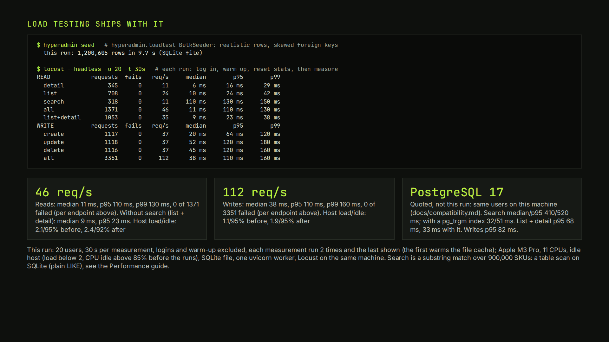

**Plugins.** Dashboard widgets and pivot reports with charts
([`hyperadmin-reports`](plugins/reports.md); the ERP lists
its "Invoices by status" and "Bills by status" reports under All reports), background
task monitoring ([`hyperadmin-tasks`](plugins/tasks.md)) and request traces
([`hyperadmin-logfire`](plugins/logfire.md)).

| 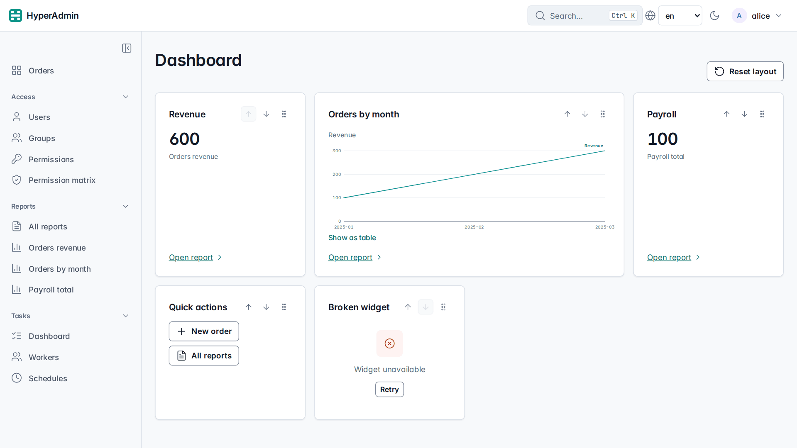 | 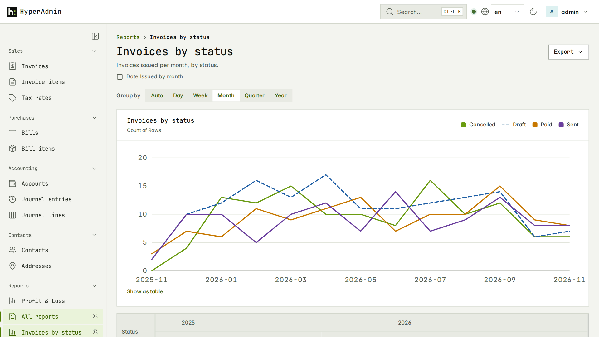 |
|---|---|
| 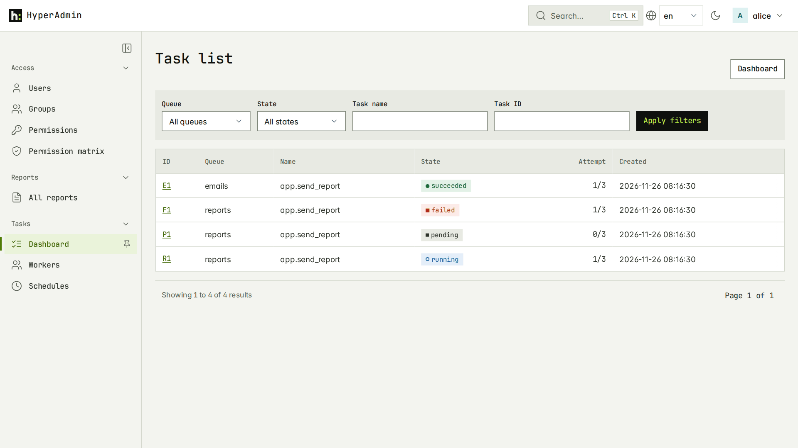 |  |

**Sign-in and languages.** Passwords, MFA and OAuth single sign-on
([OAuth SSO](guides/oauth-sso.md)). Each user picks one of 20 bundled locales from the navbar.
Ukrainian is reviewed for most strings (the few still in review, such as "Filters", show in
English); the other locales ship drafts that render English until a native speaker reviews
them, so the Arabic shot shows the right-to-left layout with English text. See
[Languages and right-to-left](guides/i18n.md).

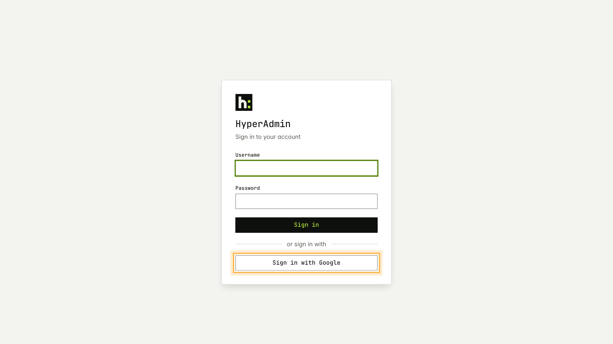

|  |  |
|---|---|

**The widget set.** Every component below comes from a field type or an option.

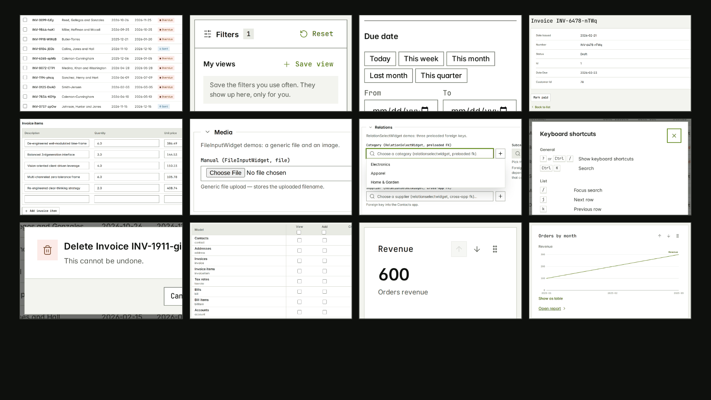

---

## Hosted demo

**[hyper-admin-demo.onrender.com/admin/](https://hyper-admin-demo.onrender.com/admin/)** —
sign in with **`demo` / `demo`**.

The demo account can manage every ERP record (contacts, invoices, bills, accounts, journal
entries, the profit-and-loss report) but not users, groups or permissions.

- It runs on a free plan and sleeps after 15 minutes without visitors, so the first page
  can take about a minute to load.
- The data is synthetic and is reset every night and on every deploy. Other visitors see
  what you enter until then, so please don't type real personal data.
- It is deployed automatically from the `develop` branch.

---

## Try it live in Codespaces

[](https://codespaces.new/yevheniidehtiar/hyper-admin?devcontainer_path=.devcontainer%2Fdevcontainer.json)

Click the badge to launch a ready-to-run dev environment (dependencies install
automatically). Once it's up, start the ERP demo:

```bash
uv run fastapi dev examples/erp/main.py --host 0.0.0.0
```

Codespaces forwards port **8000** automatically — open the preview to use the admin.
The demo seeds itself on boot (a small SQLite database, `erp.db`), so you get a fully
populated bookkeeping app: contacts, sales, purchases, accounting, and reports.

> Log in with the seeded superuser (see `examples/erp/seed.py` for credentials).

---

## Screenshot tour

The screenshots below are taken from the ERP demo above, unedited. They show exactly what
the framework renders.

### Login

Session-based authentication out of the box.

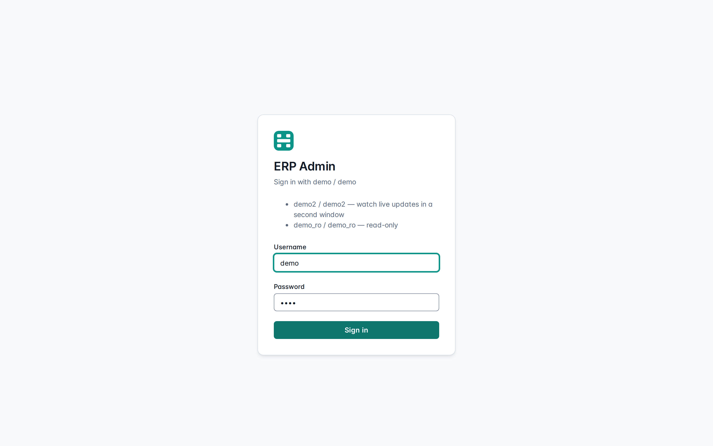

### List view

Sortable, searchable, paginated tables generated from your models — no boilerplate.

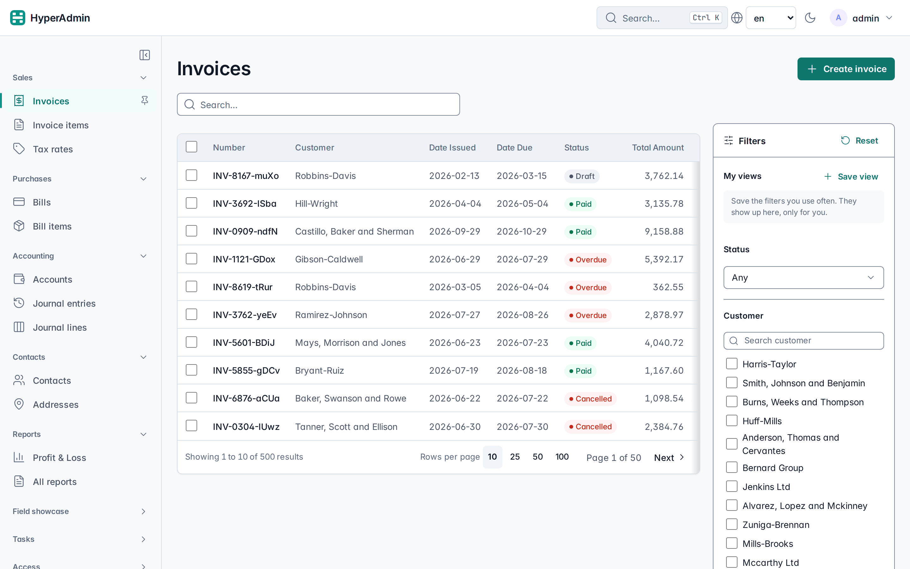

Dark mode follows the operating system, or the toggle in the navbar.

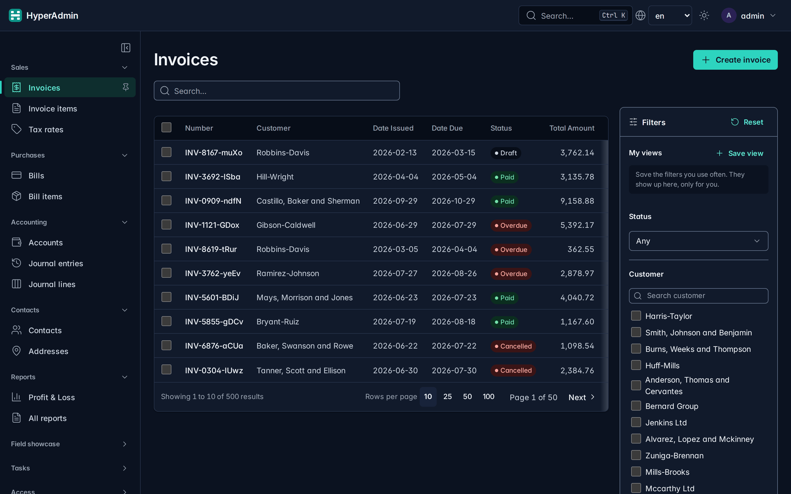

### Detail view

Per-record detail pages with related data and row actions.


### Create / edit form

Forms derived from your Pydantic/SQLModel fields, with server-side validation and
inline field errors.


### Permissions

The read-only demo account (`demo_ro`) sees no Create button and no delete buttons, and opens
rows as read-only detail pages; the server refuses any change it attempts.

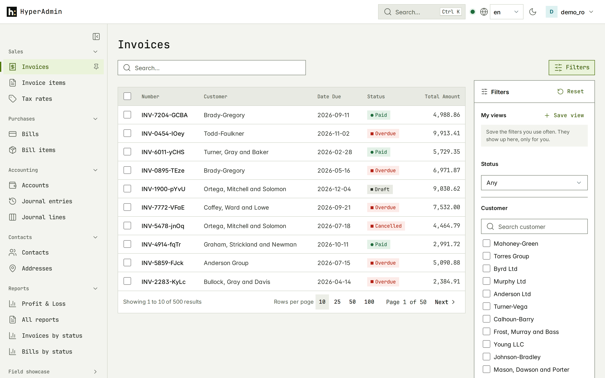

### Responsive by default

The same UI adapts to small screens.

{ width="320" }

---

## Run it locally

The demo lives in [`examples/erp/`](https://github.com/yevheniidehtiar/hyper-admin/tree/develop/examples/erp).

### With Docker

```bash
cd examples/erp
docker compose up --build
```

### Without Docker

```bash
uv sync --all-extras
uv run fastapi dev examples/erp/main.py --host 0.0.0.0
```

Then open <http://localhost:8000/admin/>.

The app uses SQLite (`sqlite+aiosqlite:///erp.db`) and reseeds on startup, so it is
safe to delete `erp.db` and start fresh at any time.
