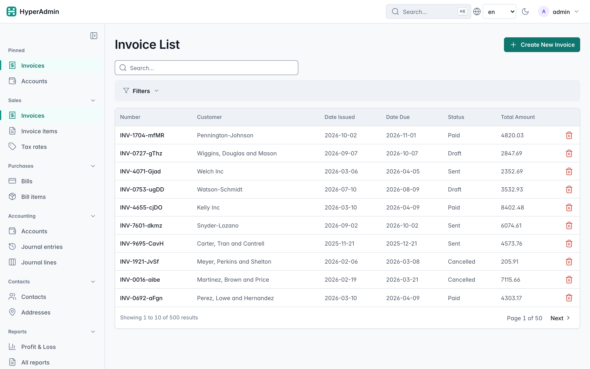
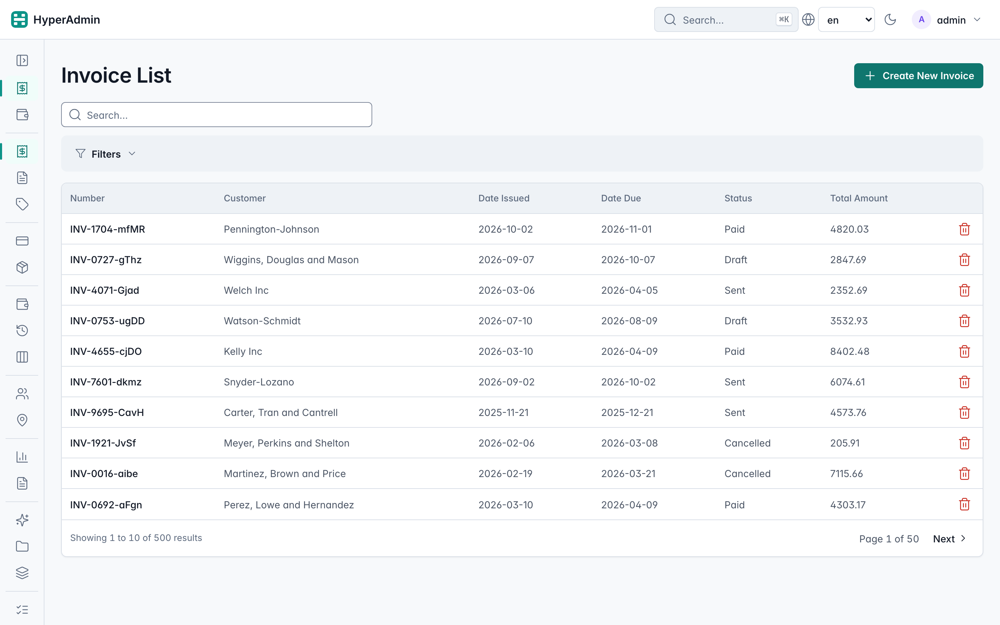
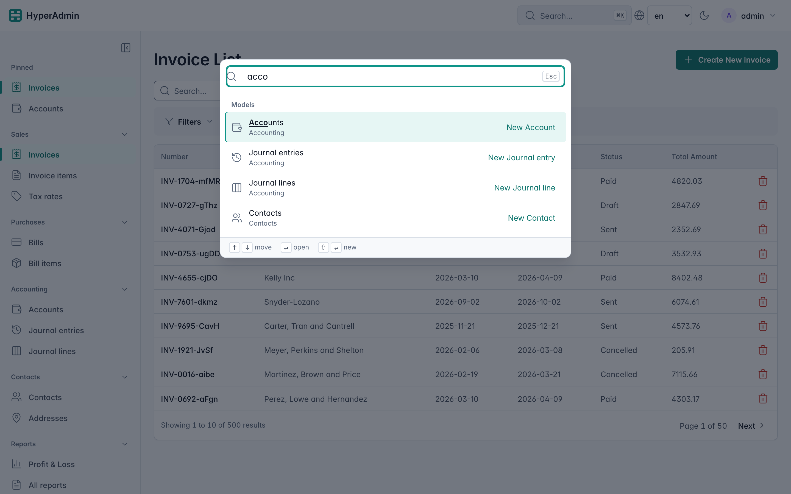
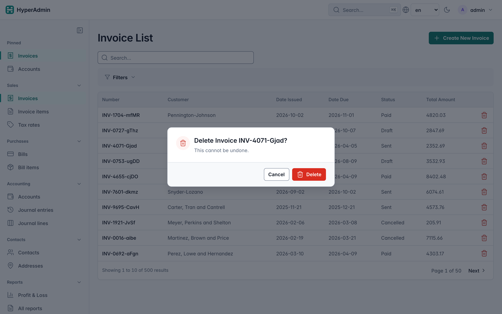
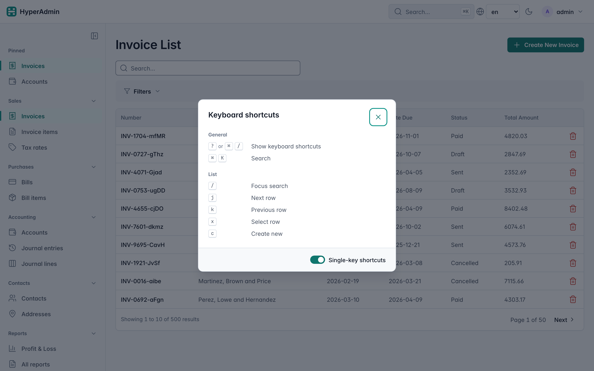
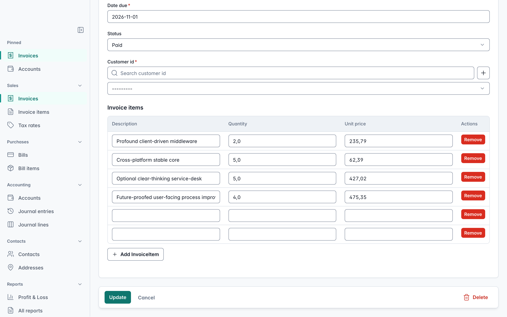
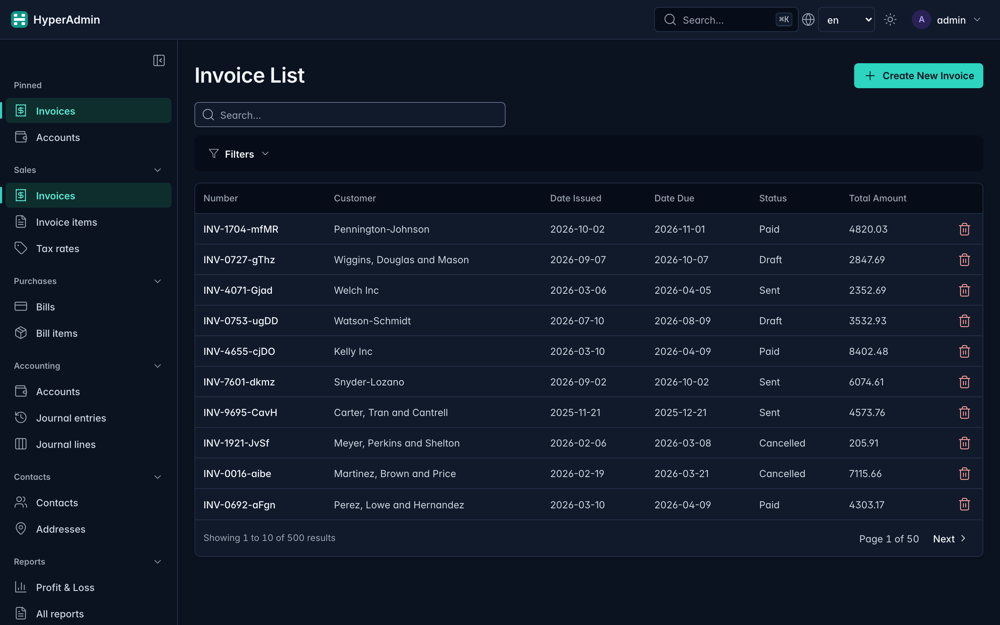

# ERP (Bookkeeping) Example

The ERP example is a full, domain-driven reference application that demonstrates HyperAdmin
in a realistic multi-module setup. It is the recommended starting point for adopters building
admin interfaces over relational data.

Source: [`examples/erp/`](https://github.com/yevheniidehtiar/hyper-admin/tree/master/examples/erp)

---

## What it demonstrates

- **Multi-module auto-discovery** — each domain (`contacts`, `sales`, `purchases`, `accounting`)
  is a standalone Python package; `Admin(discover_apps=[...])` wires them all automatically.
- **Relational data** — invoices belong to contacts, invoice items belong to invoices, journal
  lines belong to journal entries. HyperAdmin handles all FK list/detail views out of the box.
- **Built-in RBAC** — `hyperadmin.auth` is added as a discovered app; a `SessionAuthBackend` and
  `ModelPermissionChecker` guard every route.
- **Custom report** — the Annual Profit & Loss view shows how to add a page of your own (a FastAPI
  router and a Jinja2 template) inside the admin and link it from a sidebar group.
- **Navigation** — models grouped by domain with icons, per-user pinned pages, a collapsible icon
  rail and a <kbd>⌘K</kbd> command palette.
- **Lists and forms** — rows that open on click, a red delete icon with a confirmation, keyboard
  shortcuts (<kbd>j</kbd>/<kbd>k</kbd>, <kbd>x</kbd>, <kbd>c</kbd>, <kbd>?</kbd>) and a warning
  before leaving a form with unsaved changes.
- **Large seed dataset** — 100 contacts, 500+ invoices, 800+ bills give meaningful pagination,
  search, and sort behaviour under realistic load.

---

## Modules

| Module | Key Models | Description |
|--------|-----------|-------------|
| `contacts` | `Contact` | Customers and suppliers |
| `sales` | `Invoice`, `InvoiceItem` | Customer invoices with line items |
| `purchases` | `Bill`, `BillItem` | Supplier bills with line items |
| `accounting` | `Account`, `JournalEntry`, `JournalLine` | Chart of accounts, double-entry ledger |
| `auth` | `User`, `Group`, `Permission` | Built-in HyperAdmin RBAC |

---

## Quick start

### Docker (zero setup)

```bash
docker compose -f examples/erp/docker-compose.yml up --build
```

Open [http://localhost:8000/admin](http://localhost:8000/admin) — login `admin` / `admin`.

### Local (uv)

```bash
uv sync --all-extras
uv run fastapi dev examples/erp/main.py
```

Open [http://127.0.0.1:8000/admin](http://127.0.0.1:8000/admin) — login `admin` / `admin`.

### Seed command

The database is seeded automatically on first start. To reseed from scratch:

```bash
rm erp.db
uv run fastapi dev examples/erp/main.py
```

---

## Key files

| File | Purpose |
|------|---------|
| `main.py` | FastAPI app, Admin wiring, lifespan seeding |
| `db.py` | Async SQLite engine |
| `seed.py` | Faker-based seed script (contacts, invoices, bills, accounts) |
| `*/models.py` | SQLModel table definitions per module |
| `*/admin.py` | `ModelAdmin` registrations per module |
| `reports/views.py` | Custom Annual P&L FastAPI router |
| `templates/reports/profit_loss.html` | Custom Jinja2 report template |

---

## Sidebar groups and icons

Each admin class names its group, its position in it and its icon:

```python
# examples/erp/sales/admin.py (excerpt)
class InvoiceAdmin(ModelAdmin):
    nav_group = "Sales"
    nav_order = 0
    icon = "receipt"
```

`main.py` declares the groups' order, icon and whether they start collapsed:

```python
# examples/erp/main.py (excerpt)
admin = Admin(
    app,
    engine=engine,
    ...,
    nav_groups=[
        NavGroup("Sales", icon="shopping-cart", order=0),
        NavGroup("Purchases", icon="truck", order=1),
        NavGroup("Accounting", icon="wallet", order=2),
        NavGroup("Contacts", icon="users", order=3),
        NavGroup("Reports", icon="bar-chart-3", order=4),
        NavGroup("Field showcase", icon="sparkles", order=5, collapsed=True),
        NavGroup("Tasks", icon="list-checks", order=6, collapsed=True),
        NavGroup("Access", icon="shield-check", order=7, collapsed=True),
    ],
)
```

The built-in Users, Groups and Permissions join "Access" next to the permission matrix.



| | |
|---|---|
|  |  |
|  |  |
|  |  |

The screenshots are rendered from this example by `scripts/erp_screenshots.py`.

---

## Custom P&L report

The report is a plain FastAPI `APIRouter`, contributed through the plugin API so it runs inside
the admin (login, CSRF, locale, error pages) and gets a sidebar link:

```python
# examples/erp/reports/plugin.py (excerpt)
class ErpPagesPlugin:
    name = "erp"

    def on_register(self, admin):
        admin.plugins.add_page(self, router, prefix="/erp")
        admin.plugins.add_nav_entry(
            self,
            label="Profit & Loss",
            url_name="profit_loss_report",
            icon="bar-chart-3",
            section="Reports",
        )


# examples/erp/main.py, before admin.mount()
admin.plugins.register(ErpPagesPlugin(), admin=admin)
```

`section="Reports"` places the link in the Reports group, next to the `hyperadmin-reports`
pages when that plugin is installed.

The template at `templates/reports/profit_loss.html` extends `` so it
inherits the sidebar, header, and HTMX bindings without any extra setup.

Visit `/admin/erp/profit-loss?year=2024` (or leave `year` blank for the current year).

---

Next: [Frontend Overview](../frontend/overview.md)
