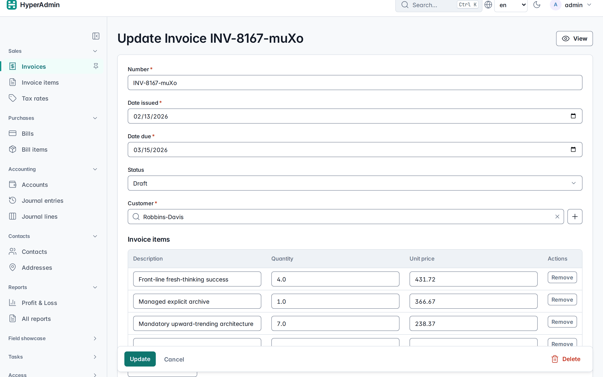
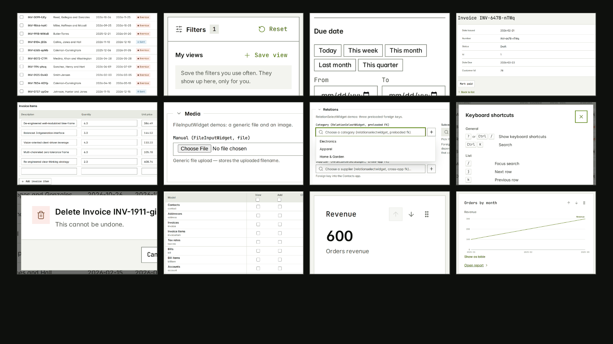

# Widgets

A **widget** controls how a single form field is rendered as HTML and what HTMX attributes, if any, it carries. Widgets are Python dataclasses that pair a Jinja2 template with optional static assets and HTMX attributes.

---

## Widget Architecture

```python
@dataclass(slots=True)
class HtmxWidget:
    template_path: str                        # Jinja2 template to render
    static_list: tuple[str, ...] = ()         # CSS/JS assets to include
    htmx_attrs: Mapping[str, str] | None = None  # hx-* attributes injected into the element
```

Every widget template receives a `FormField` context object:

```python
@dataclass(slots=True)
class FormField:
    name: str                   # HTML name attribute
    model_field: FieldInfo      # Pydantic FieldInfo (metadata, annotation)
    widget: HtmxWidget
    value: Any | None = None    # Current value (for edit forms)
    errors: list[str] | None = None

    @property
    def label(self) -> str: ...      # Human-readable label
    @property
    def required(self) -> bool: ...  # Whether the field is required
    @property
    def help_text(self) -> str | None: ...  # Field description
```

### Standard HTML Structure

All widgets follow the same outer wrapper pattern:

```html
<div class="ha-form-group">
    <label for="{{ field.name }}" class="ha-label">
        {{ field.label }}
        <span class="ha-required">*</span>
    </label>

    <!-- widget-specific input element -->

    
        <p class="ha-help-text">{{ field.help_text }}</p>
    
    
        <ul class="ha-field-errors" aria-live="polite">
            <li>{{ e }}</li>
        </ul>
    
</div>
```

---

## Built-in Widgets

### Auto-selection Logic

`PydanticForm` picks a widget automatically based on the field's Python type annotation and name. Override by passing `widgets={"field_name": MyWidget()}` to `PydanticForm`.

The column checks run first, then the name and type checks:

| Condition | Widget selected |
|---|---|
| A file upload column (`FileType`) | `FileInputWidget` |
| An image upload column (`ImageType`) | `ImagePreviewWidget`: drag-and-drop with a preview |
| A foreign key | `AutocompleteWidget` (a search box over a `<select>`, and, when the related model is registered, a "+" that creates the related row in a popup); `RelationSelectWidget` with `AdminOptions(use_autocomplete_widget=False)` |
| A many-to-many relation | `AutocompleteMultiWidget`; `RelationMultiSelectWidget` with `use_autocomplete_widget=False` |
| An `Enum` column, or a list of an `Enum` | `SelectWidget`, or `MultiSelectWidget` for a list |
| Field name is `description`, `text`, `body`, or `content` | `Textarea` |
| Annotation is `bool` | `CheckboxInput` |
| Annotation is `int` | `NumberInput` |
| Annotation is `float` | `FloatInput` |
| Annotation is `datetime` | `DateTimeInput` |
| Annotation is `date` | `DateInput` |
| Annotation is an `Enum` subclass (no column information) | `SelectInput` |
| Anything else | `TextInput` |

A foreign key to a table with at least `AdminOptions.preload_threshold` rows (500 by default)
fetches its options as the user types instead of embedding them in the form.





### TextInput

Renders `<input type="text">`. Suitable for short strings.

```html
<input id="{{ field.name }}" name="{{ field.name }}"
       type="text" value="{{ field.value or '' }}"
       class="ha-input"
       aria-invalid="{{ 'true' if field.errors else 'false' }}" />
```

### NumberInput / FloatInput

Both render `<input type="number">`. `FloatInput` adds `step="any"` to allow decimals.

### Textarea

Renders `<textarea>`. Auto-selected for fields whose name implies long-form text.

### CheckboxInput

Renders a checkbox where the label wraps the input (label-as-container pattern for larger click targets):

```html
<label for="{{ field.name }}" class="ha-checkbox-label">
    <input type="checkbox" id="{{ field.name }}" name="{{ field.name }}"
           value="true" class="ha-checkbox"
           checked />
    <span class="ha-checkbox-text">{{ field.label }}</span>
</label>
```

### SelectInput

Renders `<select>` for `Enum` fields. Iterates over enum members to produce options:

```html
<select id="{{ field.name }}" name="{{ field.name }}" class="ha-select"
        aria-invalid="{{ 'true' if field.errors else 'false' }}">
    
        <option value="{{ choice.value }}"
                selected>
            {{ choice.name }}
        </option>
    
</select>
```

### DateTimeInput

Renders `<input type="datetime-local">`.

---
