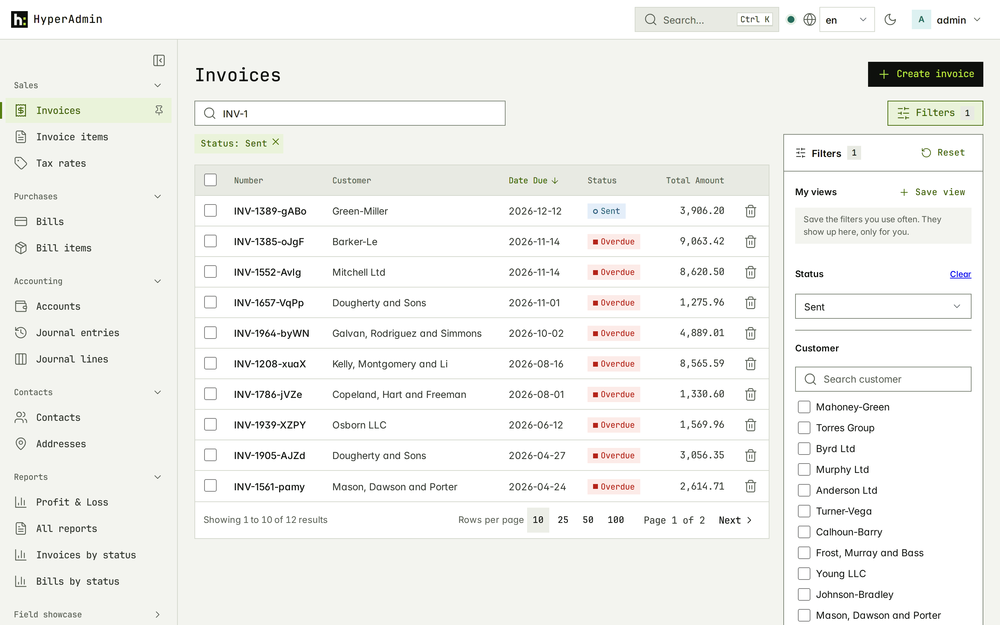

# List Filters

`AdminOptions.list_filter` decides what the filter panel beside a list shows. This page covers
the built-in filters and how to write your own.



## Field names or filter objects

`list_filter` takes field names, filter objects from `hyperadmin.filters`, or both:

```python
from hyperadmin.core.options import AdminOptions
from hyperadmin.core.registry import site
from hyperadmin.filters import DateRangeFilter

site.register(
    Invoice,
    options=AdminOptions(list_filter=[DateRangeFilter(field="issued_on"), "status"]),
)
```

- **Unset** (`None`): HyperAdmin picks filters from the model's boolean, enum and foreign-key
  columns.
- **`[]`**: no filter panel.
- **A field name** (`"status"`): a single-choice select that matches the value exactly
  (`?filter_status=paid`).
- **A filter object**: reads its own querystring keys, renders its own group in the panel and
  shows a chip above the table while it is active.

Sensitive fields can never be filtered on: a filter bound to one is left out. The querystring is
the only state, so a filtered list can be bookmarked, shared and saved as a saved view.

## Built-in filters

Every built-in filter takes `field=` (the column) and an optional `label=` (the group heading,
the title-cased field name by default).

| Filter | Shows | Querystring |
|---|---|---|
| `BooleanFilter(field=...)` | Any / Yes / No radios on a boolean column | `paid=1`, `paid=0` |
| `MultiChoiceFilter(field=..., choices=...)` | Checkboxes; matches any of the ticked values. `choices` is an `Enum` class or `(value, label)` pairs; without it the options come from the column | `status__in=draft&status__in=sent` |
| `MultiFKFilter(field=..., searchable=True)` | A checklist of related rows, selected first, with a search box | `customer_id__in=3&customer_id__in=7` |
| `DateRangeFilter(field=..., presets=...)` | From / To dates and preset buttons (`today`, `this_week`, `this_month`, `last_month`, `this_quarter`; `()` hides them). A whole day on a datetime column runs from midnight to midnight in the display timezone | `issued_on__gte=2026-01-01&issued_on__lte=2026-01-31`, `issued_on__preset=this_month` |
| `CurrentPeriodDefault(field=..., period="month")` | Pairs with a `DateRangeFilter` on the same field: on first load the list is limited to the current day, week, month, quarter or year, and the dates are written into the URL. `?issued_on=all` turns it off | |
| `IsOwnerFilter(owner_fields=...)` | A "Mine only" switch: rows whose owner column (or any of several) equals the signed-in user's key. Does nothing for anonymous users | `is_owner=1` |

```python
from hyperadmin.filters import (
    BooleanFilter,
    CurrentPeriodDefault,
    DateRangeFilter,
    IsOwnerFilter,
    MultiChoiceFilter,
    MultiFKFilter,
)

AdminOptions(
    list_filter=[
        MultiChoiceFilter(field="status", choices=InvoiceStatus),
        MultiFKFilter(field="customer_id", label="Customer"),
        DateRangeFilter(field="issued_on"),
        CurrentPeriodDefault(field="issued_on", period="month"),
        BooleanFilter(field="paid"),
        IsOwnerFilter(owner_fields=("created_by", "assigned_to")),
    ]
)
```

The related rows a foreign-key filter lists are cached for `filter_cache_ttl` seconds (60 by
default); see [Large Tables & Performance](performance.md#list-filters).

## Writing a filter

A filter is a frozen dataclass that subclasses `FilterDef`. It implements two methods and names
one template:

- `parse(qs)` reads its keys from the querystring and returns a dict, `{}` when it is inactive
  or the input is invalid;
- `compile(parsed, binding)` turns that dict into conditions for the adapter;
- `template` is the Jinja partial that renders its group in the filter panel.

A filter never builds SQL. `typed_conditions(binding, {operator: raw value})` sends the raw value
through the same pipeline as every other filter: the value is converted to the column's type,
and a value that does not convert is dropped. The operators are `""` (equals), `"gte"`, `"lte"`
and `"in"`.

This filter keeps the rows whose column is at least the number the user types:

```python title="myapp/filters.py"
from dataclasses import dataclass
from decimal import Decimal, InvalidOperation
from typing import Any, ClassVar

from hyperadmin.filters import FilterBinding, FilterDef


@dataclass(frozen=True, kw_only=True)
class MinimumFilter(FilterDef):
    template: ClassVar[str] = "filters/minimum.html"

    @property
    def query_keys(self) -> tuple[str, ...]:
        return (f"{self.field}__gte",)

    def _raw(self, qs: Any) -> str:
        return (qs.get(f"{self.field}__gte") or "").strip() if qs is not None else ""

    def parse(self, qs: Any) -> dict[str, Any]:
        try:
            return {"minimum": Decimal(self._raw(qs))} if self._raw(qs) else {}
        except InvalidOperation:
            return {}

    def error(self, qs: Any) -> str | None:
        if self._raw(qs) and not self.parse(qs):
            return "Enter a number."
        return None

    def compile(self, parsed: dict[str, Any], binding: FilterBinding | None = None) -> list:
        if not parsed:
            return []
        return self.typed_conditions(binding, {"gte": str(parsed["minimum"])})

    def describe(self, parsed: dict[str, Any]) -> str | None:
        return f"at least {parsed['minimum']}" if parsed else None
```

The template gets `filter`, `parsed`, `active`, `error` and `clear_href`. Its inputs must be
named after `query_keys`, because the panel is a plain `GET` form:

```jinja title="my_templates/filters/minimum.html"
<fieldset class="ha-filtergroup has-error" data-testid="filter-{{ filter.slug }}">
  <legend>{{ filter.title }}</legend>
  <input class="ha-input" type="text" inputmode="decimal" id="filter-{{ filter.slug }}"
         name="{{ filter.field }}__gte" value="{{ parsed.minimum if active else '' }}"
         aria-label="{{ filter.title }}">
  <p class="ha-errmsg">{{ error }}</p>
</fieldset>
```

Put the template in a directory listed in `HyperAdminSettings(template_dirs=[...])`, then use the
filter like a built-in one:

```python
AdminOptions(list_filter=[MinimumFilter(field="total", label="Total at least")])
```

What the methods do for the panel:

| Member | Used for |
|---|---|
| `query_keys` | The keys the group's "Clear" link and the chip remove. Defaults to `(field,)` |
| `error(qs)` | A message shown in the group for invalid input. Defaults to `None` |
| `describe(parsed)` | The chip text above the table while the filter is active. Defaults to `None` (no chip) |
| `context(ctx)` | The template variables; override it, call `super().context(ctx)` and add your own keys |
| `slug`, `title` | The group's test id and heading. Default to `field` and `label` |
| `value_type` | The type a raw value is converted to when the model does not declare `field`. Defaults to `str` |

`compile` receives a `FilterBinding` with the request's facts: `model`, `tz` (the display
timezone), `today_date`, `user` and `user_key`. Use it for filters that depend on the current
user or date, as `IsOwnerFilter` and `CurrentPeriodDefault` do.

## API reference

See the [filters section](../api/views.md#filters) of the Views reference.
