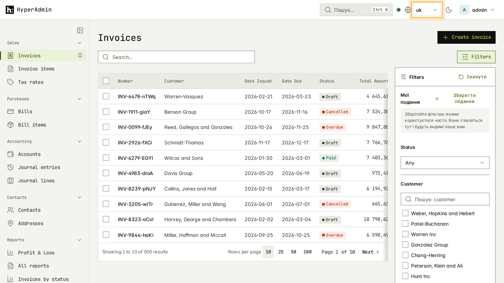
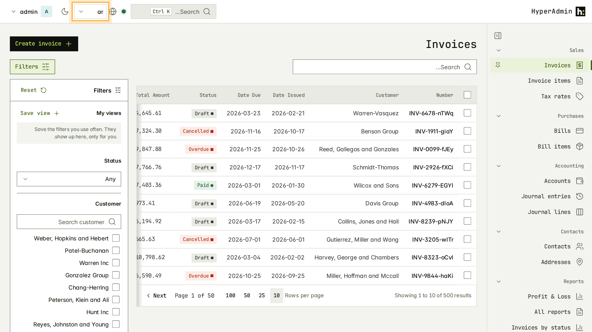

# Languages and Right-to-Left

HyperAdmin picks a language for every admin request, translates its own interface strings and
validation messages through gettext catalogs, formats numbers for that language and lays the
page out right to left for Arabic and Hebrew.

| Ukrainian | Arabic, right to left |
|---|---|
|  |  |

## How the language is chosen

For each admin request, in this order:

1. the `hyperadmin_locale` cookie, set by the language switcher in the navbar;
2. the browser's `Accept-Language` header, matched against `supported_locales`;
3. `default_locale` (`"en"`).

A cookie or header value that is not in `supported_locales` is ignored. The switcher posts to
`{prefix}/locale`, which answers 400 for an unsupported locale, sets the cookie for one year on
the admin path only, and sends the user back to the admin page they came from. The resolved
locale is in `request.state.locale`, and every admin response carries a `Content-Language`
header unless `locale_response_header=False`. Below 640px the switcher moves into the account
menu.

```python
from hyperadmin import HyperAdminSettings

settings = HyperAdminSettings(
    default_locale="uk",
    supported_locales=["en", "uk", "de"],  # the switcher offers these, in this order
)
```

The same settings read `HYPERADMIN_DEFAULT_LOCALE` and `HYPERADMIN_SUPPORTED_LOCALES` (a JSON
list) from the environment. See the [settings table](../api/application.md).

## Bundled locales

`supported_locales` defaults to 20 locales: `en`, `es`, `fr`, `de`, `zh_CN`, `ja`, `uk`, `ar`,
`he`, `hi`, `pt_BR`, `ru`, `ko`, `it`, `tr`, `pl`, `nl`, `vi`, `id` and `th`. Every one of them
switches the page direction, number formatting and plural rules. How much of the interface is
translated differs:

| Locale | Interface strings |
|---|---|
| `en` | Source language |
| `uk` | Reviewed: most strings translated |
| `de` | A few strings reviewed; the rest show in English |
| The other 17 | Draft translations only; the interface shows in English |

Draft translations are kept in the catalogs marked `fuzzy` until a native speaker reviews them,
and compiling leaves fuzzy entries out, so a string without a reviewed translation shows in
English rather than in a guess. Reviews are welcome: see [Updating the catalogs](#updating-the-catalogs).

## Right to left

For `ar` and `he` (and `fa` or `ur`, if you add them to `supported_locales`) the page renders
with `<html dir="rtl">`: the sidebar moves to the right and text, tables and forms run right to
left. The stylesheet uses logical properties (`margin-inline-start` and the like), and a few `[dir="rtl"]` rules for what logical properties cannot express (the phone sidebar drawer, select arrows); directional icons are mirrored.

## Numbers

Decimal and float list cells use the locale's grouping and decimal separators through Babel
(`4 645,61` in Ukrainian, `4,645.61` in English).

## Model and field names

`verbose_name` and `verbose_name_plural` on a `ModelAdmin` accept a lazy string, which is
translated when a page renders, in the request's language:

```python
from hyperadmin import gettext_lazy as _
from hyperadmin.core.model import ModelAdmin


class InvoiceAdmin(ModelAdmin):
    verbose_name = _("Invoice")
    verbose_name_plural = _("Invoices")
```

The lazy string is looked up in HyperAdmin's own catalogs. There is no setting yet to add a
catalog of your own, so a label that HyperAdmin's catalogs do not contain shows as written.

## Validation messages

Form errors come from Pydantic in English, with the limits already filled in ("Input should be
greater than 5"). HyperAdmin translates them by error type instead of by text, then fills in
the limits, so they follow the request's language like the rest of the interface. Error types
it does not know fall back to Pydantic's English message.

## Updating the catalogs

The catalogs live in `src/hyperadmin/locale/<locale>/LC_MESSAGES/messages.po`. In a checkout of
the repository:

```bash
poe i18n:update   # extract strings from Python and templates (babel.cfg), merge into every .po
poe i18n:compile  # compile .po to .mo; fuzzy entries are skipped
```

To review a translation, fix the `msgstr`, remove the `#, fuzzy` line above it and compile.
The unit tests check that every locale has a compiled catalog with plural rules, that draft
entries fall back to English, and that the navigation strings are in every catalog.
