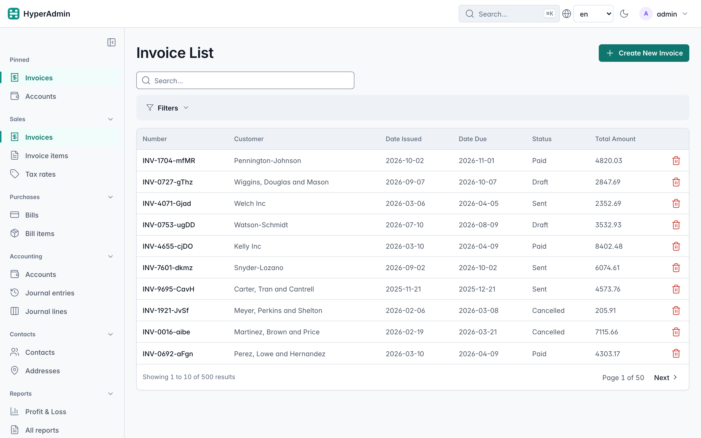
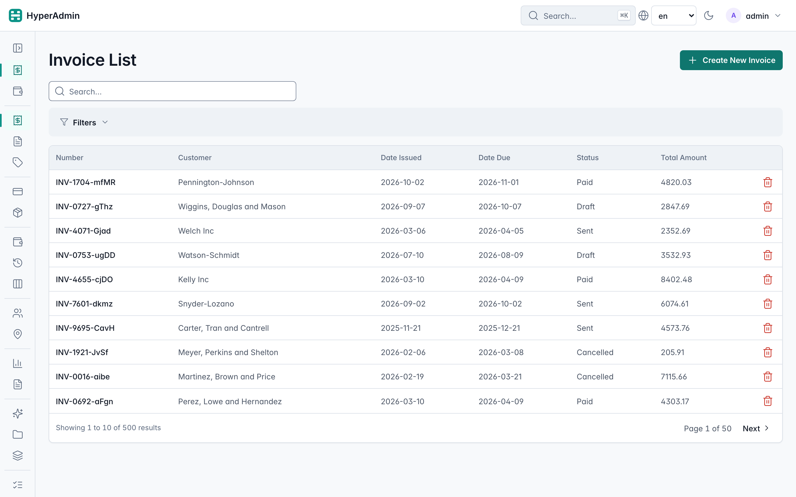
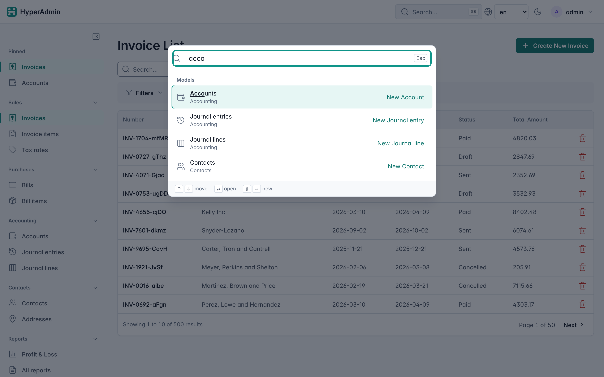
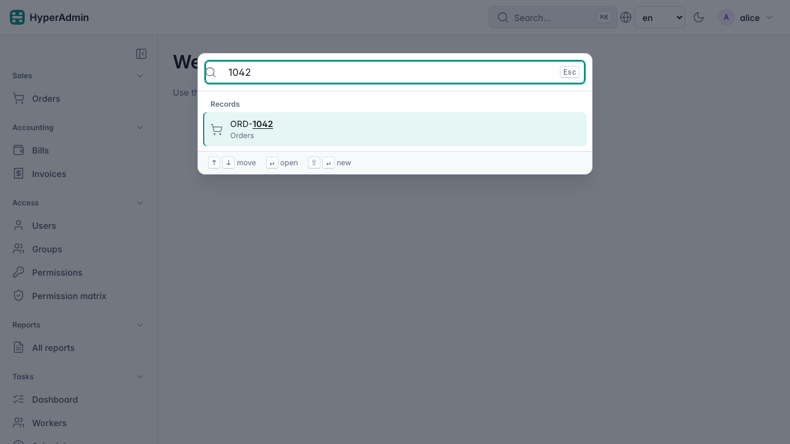
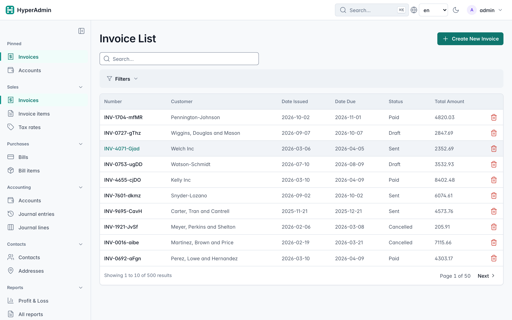
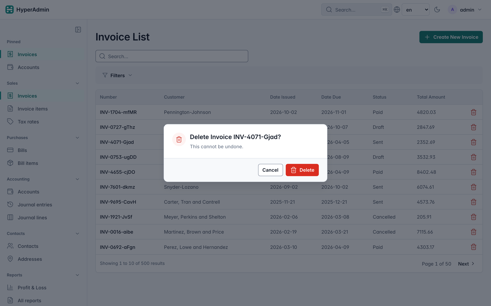
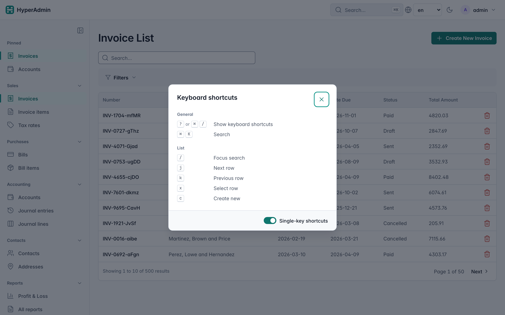
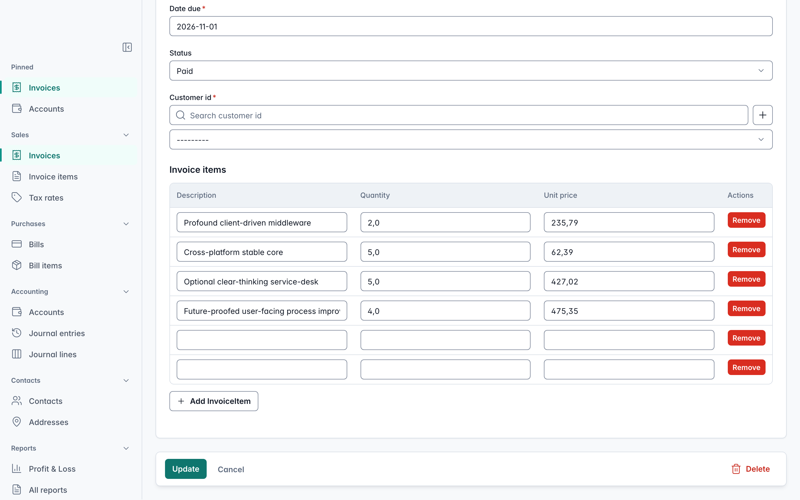

# Navigation, Lists and Keyboard

HyperAdmin's sidebar groups your models by domain, each user can pin the pages they use most,
and <kbd>⌘K</kbd> / <kbd>Ctrl+K</kbd> finds any page by name. In lists, a click anywhere on a
row opens the record, deleting asks first, and the keyboard moves between rows. Forms keep their
Save bar in view and warn before unsaved changes are lost.

The screenshots on this page come from the [ERP example](../examples/erp.md).



## Sidebar groups

Each model names its group, its position in the group and its icon on its admin class; the
`Admin` declares the order, icon and initial state of the groups:

```python
from hyperadmin import Admin, NavGroup
from hyperadmin.core.model import ModelAdmin


class InvoiceAdmin(ModelAdmin):
    nav_group = "Sales"  # plain or gettext_lazy label
    nav_order = 0  # position inside the group; ties sort by label
    icon = "receipt"  # a Lucide name from hyperadmin/static/icons


admin = Admin(
    app,
    engine=engine,
    nav_groups=[
        NavGroup("Sales", icon="shopping-cart", order=0),
        NavGroup("Accounting", icon="wallet", order=1, collapsed=True),
    ],
)
```

- Without `nav_group`, a model joins the group named by its `app_label`, and otherwise the
  unnamed group at the top of the sidebar.
- Groups you don't declare still appear, after the declared ones, sorted by label.
- The built-in Users, Groups and Permissions sit in the **Access** group, next to the
  permission matrix.
- A model without `icon` gets the generic `layout-grid` icon.
- Users see only the models they may view; a group with nothing visible is left out.
- Each group heading collapses its group, and the button at the top of the sidebar shrinks it to
  an icon rail on wide screens. Both choices are stored in cookies (`ha-nav-collapsed`,
  `ha-sidebar-rail`), so the server renders the page that way and nothing flickers.



### Your own pages in the sidebar

A page of your own joins a group through the plugin API: register an object with a `name` and an
`on_register(admin)` method before `admin.mount()`. Its router runs inside the admin (login, CSRF,
locale and error pages included), and `section` places its link in the group with that label:

```python
from fastapi import APIRouter

router = APIRouter()


@router.get("/profit-loss")
async def profit_loss_report(request): ...


class ReportsPages:
    name = "erp"

    def on_register(self, admin):
        admin.plugins.add_page(self, router, prefix="/erp")
        admin.plugins.add_nav_entry(
            self,
            label="Profit & Loss",
            url_name="profit_loss_report",  # the route's name
            icon="bar-chart-3",
            section="Reports",
            permission="view_report_pl",  # optional: hide the link from users without it
        )


admin.plugins.register(ReportsPages(), admin=admin)
admin.mount("/admin")
```

Links appended to the `nav_items` template global after `mount()`, as older apps did, still
show, in the unnamed top group.

### Pinned pages

With auth configured, every sidebar item gets a pin button on hover or focus. Pinned pages show
in a "Pinned" group at the top of the sidebar and in the command palette. They are stored per user
in the `hyperadmin_nav_pin` table, so they follow the user to any device. A user can pin up to
`HyperAdminSettings.nav_pins_max` pages (20 by default, env `HYPERADMIN_NAV_PINS_MAX`). Pins of a
page the user may no longer view are hidden. Without auth there are no pins.

If you manage the schema with Alembic, add the table as described in
[Add HyperAdmin to an existing app](existing-app.md).

## Command palette

<kbd>⌘K</kbd> / <kbd>Ctrl+K</kbd>, or the "Search… ⌘K" button in the top bar, opens the palette.
It matches models, plugin pages and group names as you type ("acco" lists every Accounting model),
lists the pages and records you opened recently, and offers "New …" for models the user may add
(<kbd>Shift+Enter</kbd>).



The palette searches in the browser, over a list of the pages the user may open that is embedded in
every page, so typing sends no requests unless a model opts in to record search (below). Recent visits are kept in the browser's localStorage
(`ha-recent`, the last 8). A custom page can record itself as a recent visit with
`<body data-ha-recent='{"label": "Q3 forecast", "url": "/admin/erp/forecast", "kind": "page"}'>`.

### Finding records

A model can let the palette find its records too. It is off by default, so the palette never queries a
table you did not opt in:

```python
from hyperadmin.core.model import ModelAdmin
from hyperadmin.core.options import AdminOptions


class OrderAdmin(ModelAdmin):
    options = AdminOptions(palette_search=True, search_fields=["number", "customer_name"])
```

Typing "1042" now lists order "ORD-1042" under **Records**, after the matching models and pages.
<kbd>Enter</kbd> opens its edit page, or its detail page for users who may only view orders.



- The palette asks the server 250 ms after you stop typing, and only for 2 characters or more.
- It uses the list search: the model's `search_fields` and its `get_queryset()`, so users only find
  records they could find on the list page. Users without `view_<model>` get nothing, and the table
  is not queried for them.
- At most 5 records per model and 6 models per search. A model without search fields is skipped.

## Lists and deleting

A click anywhere on a row opens the record: the edit page for users who may change it, the detail
page for read-only users, and nothing for users who may do neither. The link is a real link in the
row's first column, so middle-click and "open in new tab" work. Checkboxes, inline-editable cells
and links inside cells keep working on their own.



Delete is a red icon, shown only to users who may delete. It opens a confirmation that names the
record; Cancel and <kbd>Esc</kbd> keep it. Detail pages offer Edit and Delete, and edit pages offer
View and Delete, under the same permission rules.



A custom template can reuse the dialog: any element with
`data-ha-confirm-delete="<DELETE url>"` and `data-ha-label="<record name>"` opens it, and on
confirm the dialog sends the DELETE request with the CSRF header.

## Keyboard

Press <kbd>?</kbd> on any admin page to list the shortcuts. On macOS, Cmd replaces Ctrl.

| Keys | Where | What it does |
|---|---|---|
| <kbd>?</kbd> or <kbd>Ctrl+/</kbd> | everywhere | Show the shortcuts and the "Single-key shortcuts" switch |
| <kbd>Ctrl+K</kbd> | everywhere | Open the command palette |
| <kbd>/</kbd> | lists | Focus the search box |
| <kbd>j</kbd> / <kbd>k</kbd> | lists | Focus the next / previous row; <kbd>Enter</kbd> opens it |
| <kbd>x</kbd> | lists | Select the focused row for a bulk action |
| <kbd>c</kbd> | lists | Create a new record |
| <kbd>Ctrl+S</kbd> | forms | Save the form (or the open "+" popup form) |



Single-key shortcuts do nothing while you type in a field. The switch in the overlay turns them off
in this browser (localStorage `ha-shortcuts`); <kbd>Ctrl+K</kbd>, <kbd>Ctrl+S</kbd> and
<kbd>Ctrl+/</kbd> keep working.

Your own scripts can add shortcuts; they then appear in the overlay:

```js
window.haShortcuts.register({
  keys: "i",                          // or "mod+e", "alt+i", "shift+enter"
  description: "Go to invoices",      // shown in the ? overlay
  scope: "global",                    // overlay section: "global", "list", "form", ...
  single: true,                       // a single key: off in fields and when switched off
  handler: function (event) { location.href = "/admin/invoice"; },
});
```

`keys` uses `mod` for Cmd on macOS and Ctrl elsewhere. Return `false` from the handler to let the
key through. `register()` returns a function that removes the shortcut.

## Unsaved changes

Create and edit forms keep the Save bar at the bottom of the screen while you scroll. When a form
has unsaved changes, leaving the page asks first. Saving doesn't ask, and deleting the record from
its edit page asks only in the delete dialog.



Turn the warning off for a model with `AdminOptions(warn_unsaved_changes=False)`.

## Custom sidebar templates

If you override `_sidebar.html`, the flat `nav_items` and `plugin_nav` globals keep their shape.
For the grouped tree, use `visible_nav_tree()` (the groups and items the current user may view) and
`nav_pinned_items()` (the user's pins, or `None` when pins are off). The test ids for
end-to-end tests (`nav-<key>`, `nav-group-<slug>`, `row-link`, `dialog-confirm-delete`,
`command-palette` and others) are listed in the repository's `CLAUDE.md`.
