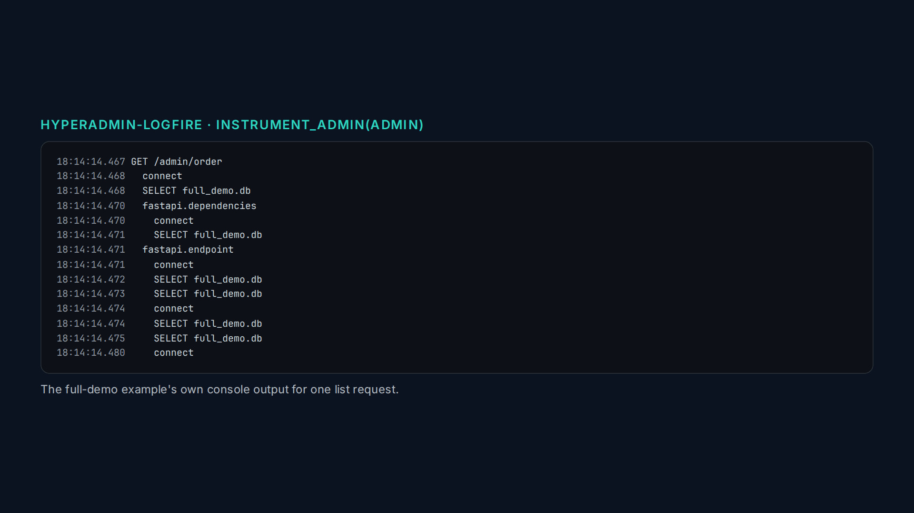

# Logfire Traces

The `hyperadmin-logfire` plugin sends admin traces to [Pydantic Logfire](https://logfire.pydantic.dev):
a span for every admin request, a span for every adapter operation and the SQL queries nested
under them.



## Install

The plugin is not on PyPI yet. Install it from the repository:

```bash
uv add "hyperadmin-logfire @ git+https://github.com/yevheniidehtiar/hyper-admin#subdirectory=plugins/hyperadmin-logfire"
```

It depends on `logfire[fastapi,sqlalchemy]` 5.x. HyperAdmin discovers it through the
`hyperadmin.plugins` entry point (`logfire`).

## Use

Configure Logfire as usual, then call `instrument_admin` after `admin.mount()`:

```python
import logfire
from hyperadmin import Admin
from hyperadmin_logfire import instrument_admin

logfire.configure()  # your token, environment, scrubbing and sampling live here

admin = Admin(app, engine=engine)
admin.mount("/admin")
instrument_admin(admin)
```

Without a Logfire token, `logfire.configure(send_to_logfire="if-token-present")` prints the span
tree in the server's terminal, as in the screenshot, and nothing leaves the machine. The
`examples/full-demo` app is wired this way.

- `instrument_admin` is idempotent and does nothing when the plugin is disabled
  (`disabled_plugins=["logfire"]` or `HYPERADMIN_DISABLED_PLUGINS=logfire`).
- Pass `http=False` or `sql=False` when your app already instruments FastAPI or SQLAlchemy
  itself. If your app called `logfire.instrument_sqlalchemy()` first, the plugin leaves
  SQLAlchemy to it.
- An admin built from a `session_factory` only has no engine to instrument: call
  `logfire.instrument_sqlalchemy(engine=...)` on your own engine.

## What you get

| Spans | Where they come from |
|---|---|
| HTTP | FastAPI's native telemetry on FastAPI 0.143 and later. On older FastAPI (from 0.116), `logfire.instrument_fastapi` on the admin's own sub-application, so your other routes are left alone (on the host app in the legacy `mount_mode="router"`) |
| SQL | `logfire.instrument_sqlalchemy` on SQLAlchemy 2.0. On SQLAlchemy 2.1, which the OpenTelemetry instrumentor does not support yet, the plugin's own spans with the same names and `db.*` attributes |
| Adapter | `admin.adapter.<op>` for every data operation of a model view (`list`, `get`, `create`, `update`, `delete`, `get_related`, `get_choices`), recorded through the [adapter-call hooks](hooks.md#adapter-calls) as soon as the plugin is installed and Logfire is configured |

Adapter spans carry the model, the operation and its non-personal arguments: `page`,
`page_size`, `search`, `has_filters` and `result_count` for a list, `pk` for one record, the
number of fields written (never their values) and the relation `field`. A call that raises ends
its span with the exception.

FastAPI's native telemetry traces every app in the process once `logfire.configure()` has run,
whether or not the plugin is enabled. Turn it off with `FastAPI(telemetry={"tracing": False})`.

Validation errors and sign-in events are not recorded yet.
