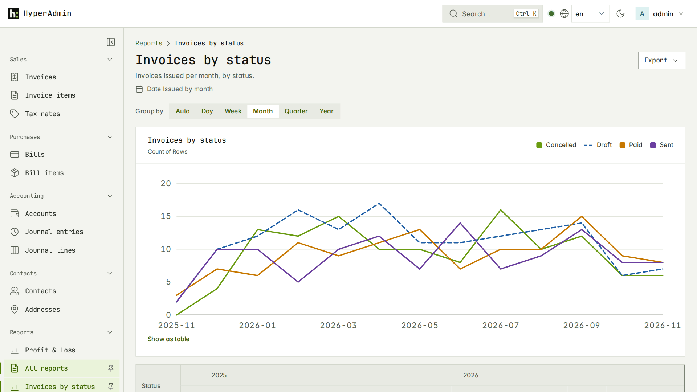
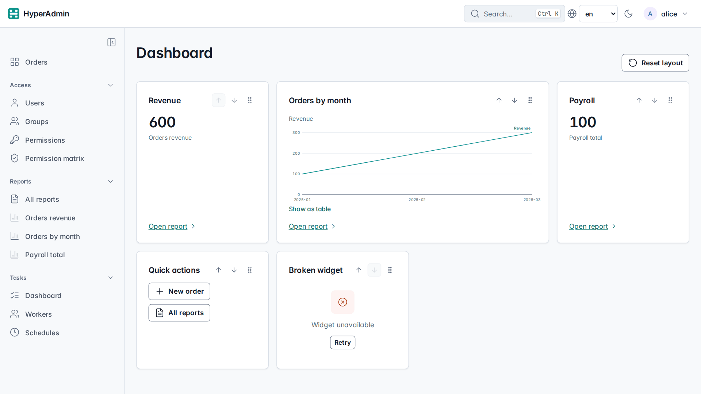
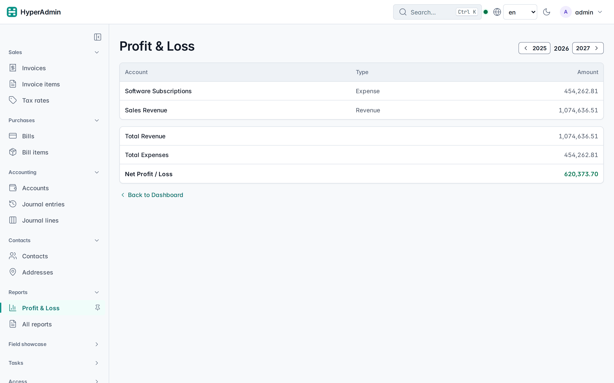
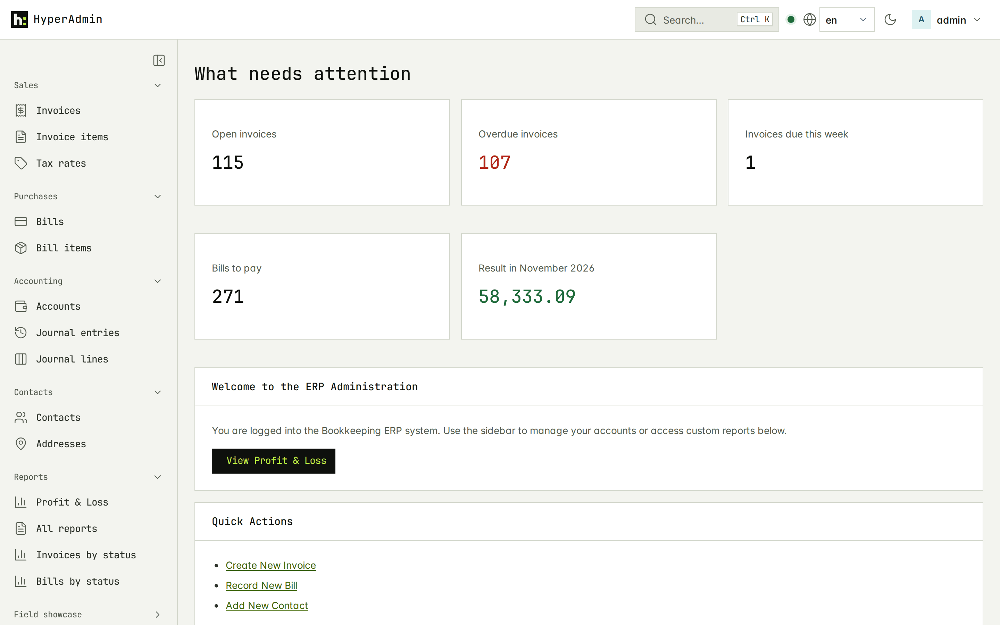

# Reports and Dashboard

The `hyperadmin-reports` plugin adds aggregated reports to the admin: a crosstab grid with
totals, a server-rendered SVG chart, CSV and XLSX export and the list view's filter sidebar.
With widgets registered, it also replaces the admin home page with a dashboard of report
numbers, report charts and shortcut links.

| Report page | Dashboard |
|---|---|
|  |  |

## Install

The plugin is not on PyPI yet. Install it from the repository:

```bash
uv add "hyperadmin-reports @ git+https://github.com/yevheniidehtiar/hyper-admin#subdirectory=plugins/hyperadmin-reports"
```

It depends on `openpyxl` for the XLSX export. HyperAdmin discovers it through the
`hyperadmin.plugins` entry point (`reports`); turn it off with
`Admin(disabled_plugins=["reports"])`.

## Declare a report

A report is a `ReportView` subclass over one model: row and column dimensions, and the values
to aggregate.

```python
from hyperadmin_reports import Count, Group, ReportView, Sum, TimeBucket, register_report


class InvoicesByStatus(ReportView):
    slug = "invoices-by-status"
    label = "Invoices by status"
    description = "Invoices issued per month, by status."
    model = Invoice
    rows = [Group("status")]
    cols = [TimeBucket("date_issued", period="month")]
    values = [Count()]


class OrderRevenue(ReportView):
    slug = "orders-revenue"
    model = Order
    rows = [Group("sku")]
    cols = [TimeBucket("created_at", period="auto")]
    values = [Sum("amount")]


register_report(InvoicesByStatus)
register_report(OrderRevenue)
admin = Admin(app, engine=engine)
admin.mount("/admin")
```

Register reports **before** `Admin(...)` is built: the plugin declares each report's permission
and sidebar link while the admin loads it.

| Building block | What it does |
|---|---|
| `Group("field")` | One row or column per distinct value. An enum shows its value ("Paid") |
| `TimeBucket("field", period=...)` | Buckets a date or datetime column by `day`, `week`, `month`, `quarter` or `year`. `"auto"` picks the bucket from the date range and says why on the page |
| `Sum`, `Count`, `Min`, `Max` | Aggregates with row, column and grand totals |
| `StringAggComma`, `Many2One` | Aggregates without totals |
| `cache = FactTableSource(model=...)` | Read a table you build and refresh yourself instead of `model`; HyperAdmin never creates or migrates it |
| `permission = "..."` | The codename that gates the report; default `view_report_{slug}` (`-` becomes `_`) |

`ReportView.run(session)` runs the same query from code and returns a result whose `pivot()`
gives the crosstab, for a scheduled export or a test.

## Pages and exports

| Route | Response |
|---|---|
| `{prefix}/reports/` | The reports the user may view, as cards |
| `{prefix}/reports/{slug}/` | The chart, then the crosstab with totals and a bucket switch |
| `{prefix}/reports/{slug}/chart` | The chart alone, as an HTML fragment you can embed in your own template |
| `{prefix}/reports/{slug}/export.csv` | UTF-8 CSV with totals |
| `{prefix}/reports/{slug}/export.xlsx` | XLSX: a "Filters used" sheet, then the grid with totals |

All of them take `?period=auto|day|week|month|quarter|year`, and the export links carry the
page's query string, so a download matches what is on screen. The chart is a line chart when a
time bucket runs along the x axis, a bar chart for a single group and a stacked bar chart for
rows by columns. It shows at most six series and says so in its caption when it leaves some out.

A user without the report's codename gets a 403 card that names the permission to ask for.
Without auth every report is open.

## Filters

`filters` takes what `list_filter` takes: field names or `hyperadmin.filters` definitions.
They are applied before the aggregate, the page gets the list view's filter sidebar, and the
grid, the chart and both exports read the same query string.

```python
from hyperadmin.filters import DateRangeFilter


class OrderRevenue(ReportView):
    slug = "orders-revenue"
    model = Order
    rows = [Group("sku")]
    cols = [TimeBucket("created_at", period="auto")]
    values = [Sum("amount")]
    filters = [DateRangeFilter(field="created_at"), "status"]


result = await OrderRevenue.run(session, filters={"created_at__gte": "2026-02-01"})
```

Filters narrow what the report's permission already allows; they are not access control. A
report reads its table directly, so `ModelAdmin.get_queryset` scoping does not apply to it:
scope a report with its own permission codename.

## Dashboard

Register widgets after their reports and before `Admin(...)`. Registration order is the default
card order.

```python
from hyperadmin_reports import (
    ChartWidget,
    QuickAction,
    QuickActionsWidget,
    StatWidget,
    register_widget,
)

register_widget(StatWidget(OrderRevenue))      # grand total of its first aggregate
register_widget(ChartWidget(InvoicesByStatus))  # the report's chart
register_widget(QuickActionsWidget([
    QuickAction("New order", "order-create-form", permission="add_order"),
    QuickAction("All reports", "reports-index"),
]))
admin = Admin(app, engine=engine)
```

| Widget | Shows |
|---|---|
| `StatWidget(report)` | One total of a report aggregate (`value=` picks the aggregate) |
| `ChartWidget(report)` | The report's chart |
| `QuickActionsWidget(actions)` | Links to named admin routes; an action with a `permission` shows only to users who hold it |
| A `DashboardWidget` subclass | Anything else: `render()` returns a template and its context |

Every card takes `key`, `title` and `span` (1 to 4 grid columns). A mistake (a duplicate key, an
unregistered report, an aggregate without totals) raises `ValueError` when the widget is built
or registered, not on the first request.

- **Permissions.** A stat or chart card shows only to users who hold its report's codename.
- **Failures.** A card whose `render()` raises shows "Widget unavailable" with a Retry button;
  the other cards are not affected.
- **Order.** Signed-in users reorder cards by dragging the handle or with the "Move up" /
  "Move down" buttons, which work from the keyboard and without JavaScript. "Reset layout"
  returns to the default order.

The order is stored per user in `hyperadmin_reports_dashboard_layout`, a table the plugin keeps
on its own metadata, so it never appears in your migrations unless you add it. Create it once
with `await create_layout_table(engine)`, or add `dashboard_metadata()` to Alembic's
`target_metadata`. Without the table the dashboard shows the default order, hides the reorder
controls and logs one warning.

### Settings

`Admin(plugin_settings={"reports": {...}})` or `HYPERADMIN_REPORTS_*` environment variables:

| Setting | Default | Meaning |
|---|---|---|
| `dashboard_home` | `True` | Serve the dashboard at `{prefix}/`. `False` keeps the welcome page and adds a "Dashboard" link to the "Reports" sidebar group |
| `dashboard_layouts` | `True` | Remember each user's order. `False` shows the default order without reorder controls |
| `dashboard_prefix` | `"/dashboard"` | Where the dashboard page is also served; change it when a model's slug is `dashboard` |

The dashboard takes over the home page through the `set_home_page()` plugin seam; only one
plugin can set the home page.

## A custom report page

Reports are declarative. For a page that does not fit a crosstab, add your own router as a
[plugin page](authoring.md). The ERP example's Profit & Loss statement and its home page
figures are built that way:

| Profit & Loss page | ERP home page |
|---|---|
|  |  |

The plugin's [README](https://github.com/yevheniidehtiar/hyper-admin/tree/develop/plugins/hyperadmin-reports)
lists every route name, the chart rules and an Alembic revision for the layout table.
