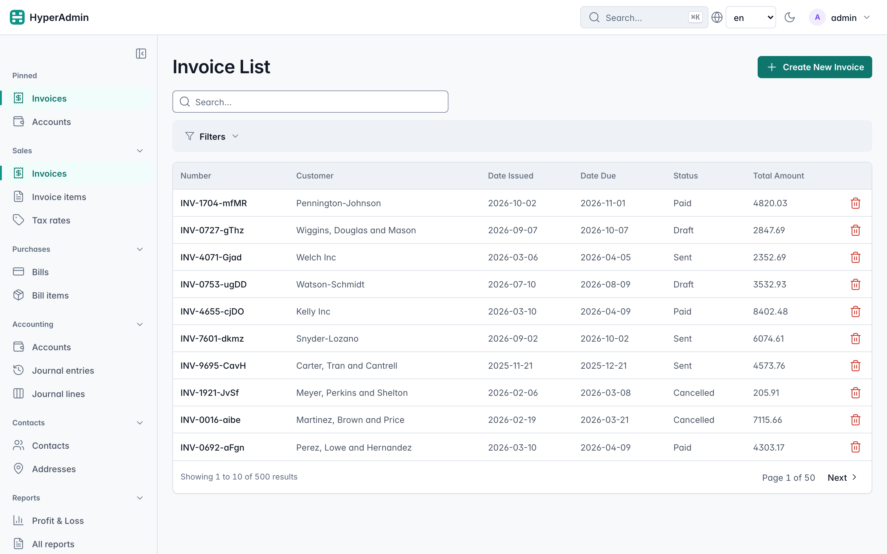
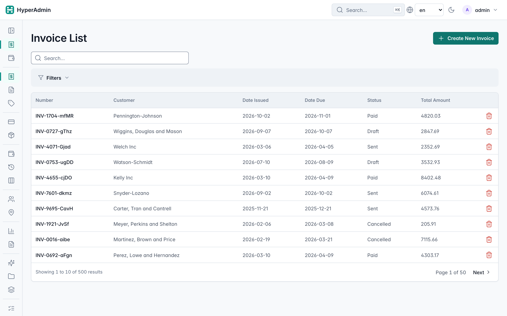
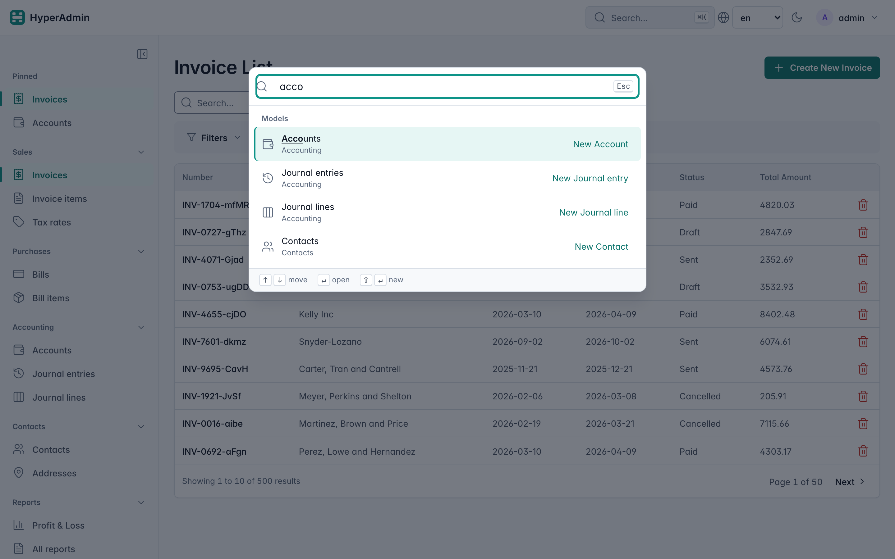
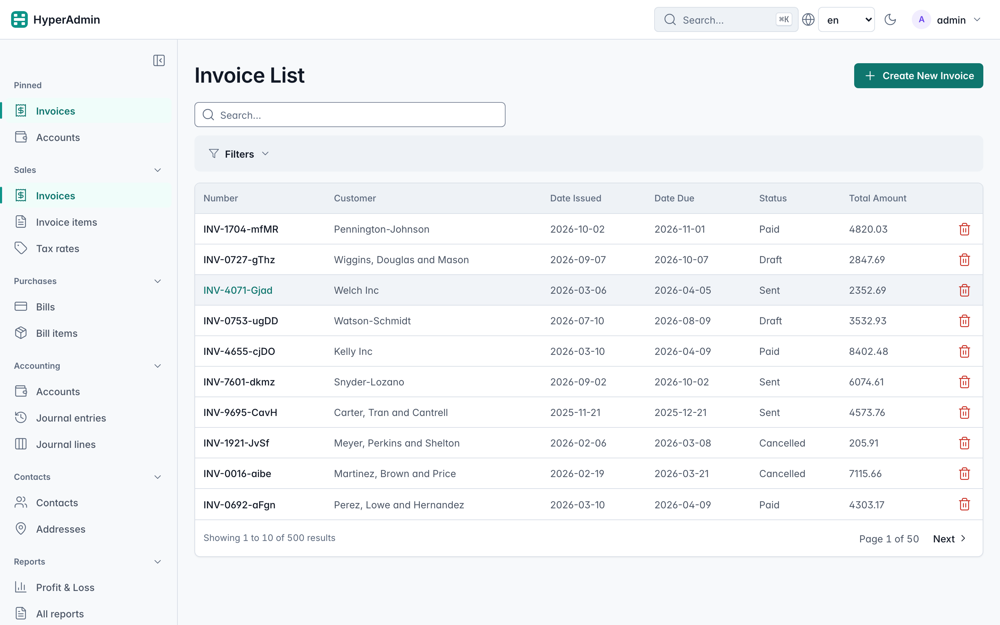
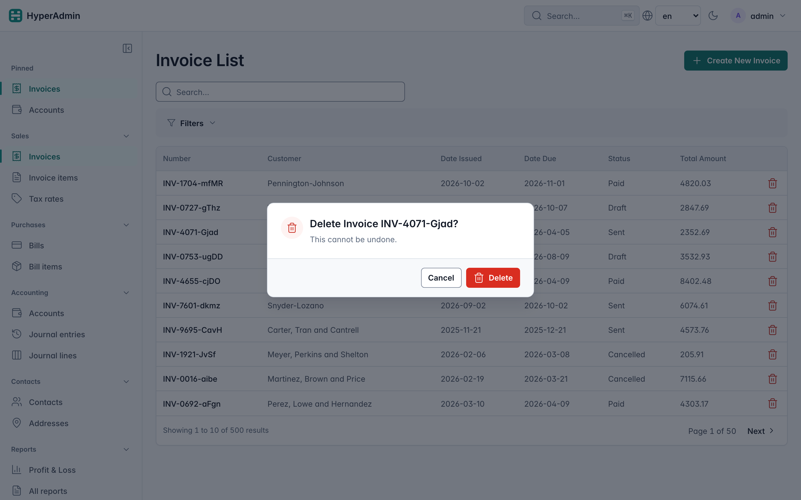
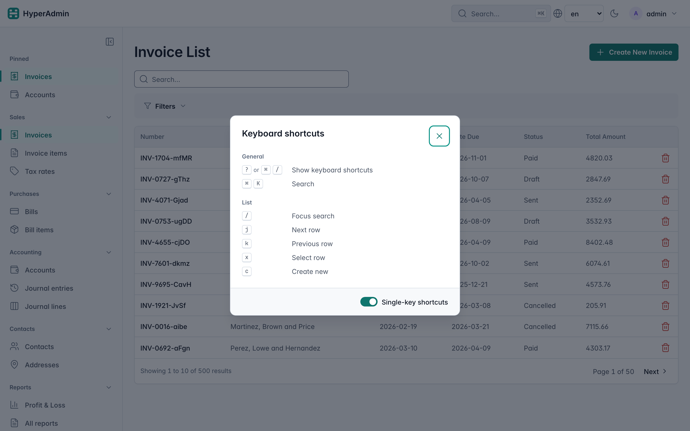
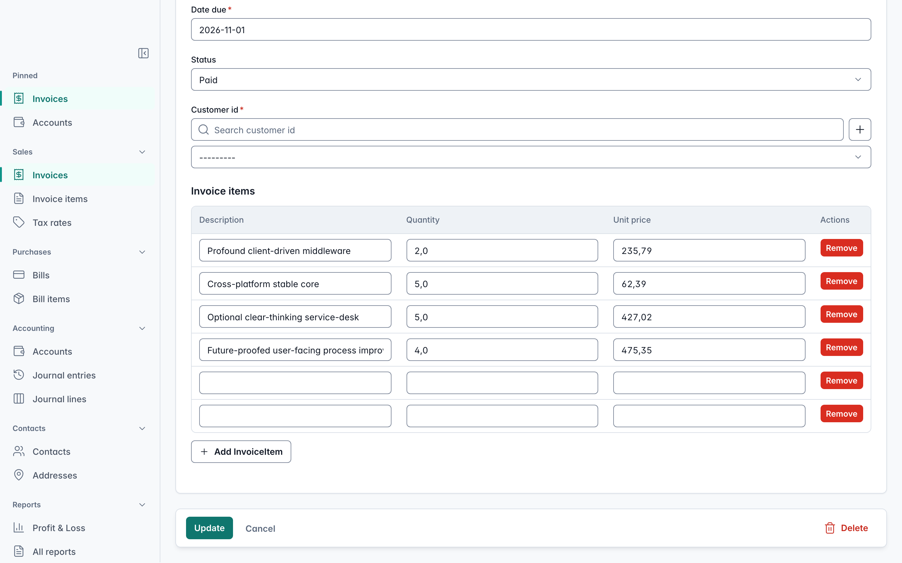
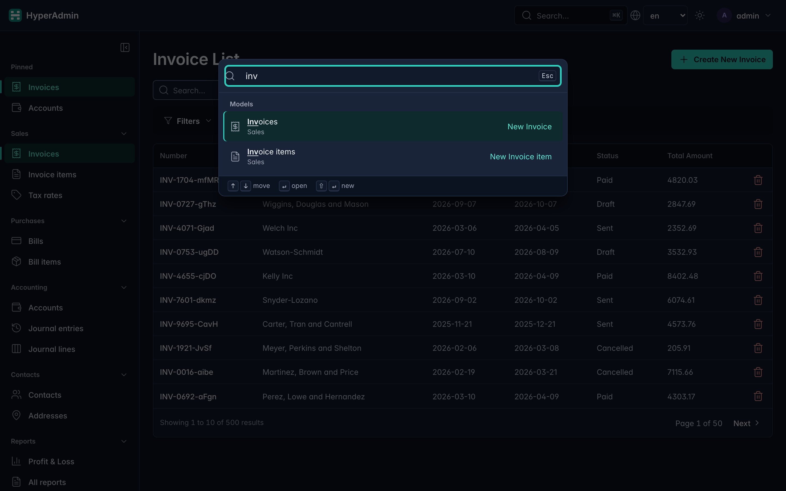
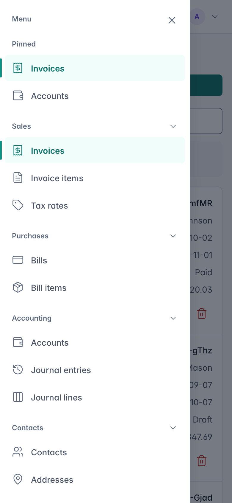

# Bookkeeping ERP Example

A comprehensive, domain-driven reference application demonstrating **HyperAdmin** with relational
data, multi-module auto-discovery, and a custom Annual Profit & Loss report.

---

## Modules

| Module | Key Models | Description |
|--------|-----------|-------------|
| `contacts` | `Contact` | Customers and suppliers |
| `sales` | `Invoice`, `InvoiceItem` | Customer invoices with line items |
| `purchases` | `Bill`, `BillItem` | Supplier bills with line items |
| `accounting` | `Account`, `JournalEntry`, `JournalLine` | Chart of accounts and double-entry ledger |
| `auth` | `User`, `Group`, `Permission` | Built-in HyperAdmin RBAC |

Custom report: **Annual Profit & Loss** — aggregates revenue and expense journal lines for any
calendar year and renders a formatted HTML report at `/admin/erp/profit-loss`.

---

## Running the example

### Docker (recommended — zero setup)

```bash
docker compose -f examples/erp/docker-compose.yml up --build
```

Open [http://localhost:8000/admin](http://localhost:8000/admin).

### Local (uv)

```bash
# Install all extras (faker, aiosqlite, etc.)
uv sync --all-extras

# Start the dev server — DB is created and seeded automatically on first run
uv run fastapi dev examples/erp/main.py
```

Open [http://127.0.0.1:8000/admin](http://127.0.0.1:8000/admin).

Login with **`admin`** / **`admin`**.

---

## Seeding

The database is seeded automatically on every cold start (when the DB is empty). The seed script
creates:

- 1 superuser (`admin` / `admin`)
- 100 contacts (mix of customers and suppliers)
- 500+ invoices with line items and journal entries
- 800+ bills with line items and journal entries
- A complete chart of accounts

To re-seed, delete the SQLite file and restart:

```bash
rm erp.db
uv run fastapi dev examples/erp/main.py
```

---

## Realtime

Realtime notifications are on by default: when someone creates, edits or deletes a record,
every other open list of that model re-fetches and highlights the changed row. The ledger
models (`JournalEntry`, `JournalLine`) opt out with `realtime_notifications=False`, because
invoices and bills write them as a side effect. Set `DEMO_REALTIME=0` to turn the whole layer
off (the load-test stack does this).

**Local (one process).** `uv run fastapi dev examples/erp/main.py` keeps pub/sub and presence
in memory. Open two browser windows on the same list, edit a record in one, and watch the
other update.

**Compose (two workers, Redis, PostgreSQL).** `docker compose -f examples/erp/docker-compose.yml up --build`
starts `postgres:16`, `redis:7-alpine` and the app with `uvicorn --workers 2`. With `REDIS_URL`
set, pub/sub and presence go through Redis, so an event published by one worker reaches sockets
held by the other. To see the fan-out, open two windows (use a private window for the second one
so the load balancer is likelier to hand it to the other worker), edit an invoice in one, and
check that the Invoices list in the other re-fetches. If Redis is down, the app keeps serving
requests and only logs warnings; events are not delivered across workers until it is back.

**Hosted demo.** With `HYPERADMIN_DEMO=1` the login page lists three public accounts:

| Account | Password | Use |
|---|---|---|
| `demo` | `demo` | Full ERP access except users, groups and permissions |
| `demo2` | `demo2` | Same permissions as `demo`: sign in from a second window to watch live updates |
| `demo_ro` | `demo_ro` | Read-only: only `view_*` permissions, still receives live updates |

---

## Screenshots

Rendered from this example with `uv run python scripts/erp_screenshots.py` (it starts the app,
signs in and saves the PNGs to `docs/assets/screenshots/`).

**Sidebar groups, icons and pinned pages.** Every model sets `nav_group`, `nav_order` and `icon`;
`main.py` declares the groups' order, icon and initial state with `NavGroup`. Pin a page with the
pin button that appears on hover; pins follow the user to any browser.



**Icon rail.** The button at the top of the sidebar collapses it to icons; the choice is kept in a
cookie, so the next page renders collapsed with no flicker.



**Command palette.** <kbd>⌘K</kbd> / <kbd>Ctrl+K</kbd> finds any page by its name or its group's
name ("acco" lists the Accounting models); <kbd>Shift+Enter</kbd> opens the "New …" form.



**Clickable rows and delete.** Click anywhere on a row to edit it (or to view it, for read-only
users). Delete is a red icon that asks first.




**Keyboard.** <kbd>j</kbd>/<kbd>k</kbd> move between rows, <kbd>Enter</kbd> opens one,
<kbd>x</kbd> selects it, <kbd>c</kbd> creates; <kbd>?</kbd> lists every shortcut and turns
single-key shortcuts off.



**Unsaved changes.** Forms keep their Save bar in view and ask before you leave with unsaved
edits; <kbd>⌘S</kbd> / <kbd>Ctrl+S</kbd> saves.



**Dark mode and phone.**




---

## Custom P&L report

`reports/plugin.py` mounts the report at `/admin/erp/profit-loss` and links it from the
**Reports** sidebar group (next to the pages of the `hyperadmin-reports` plugin, when installed).
It queries `JournalLine` records joined to `Account` and `JournalEntry` for the selected year and
groups them by account type (Revenue / Expense).

Open **Reports → Profit & Loss** in the sidebar, or visit:
[http://127.0.0.1:8000/admin/erp/profit-loss](http://127.0.0.1:8000/admin/erp/profit-loss)
